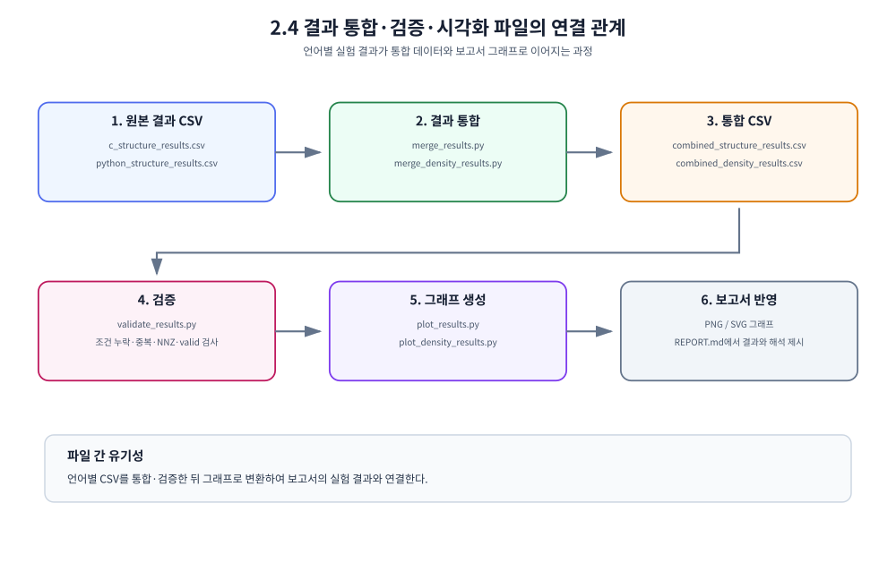
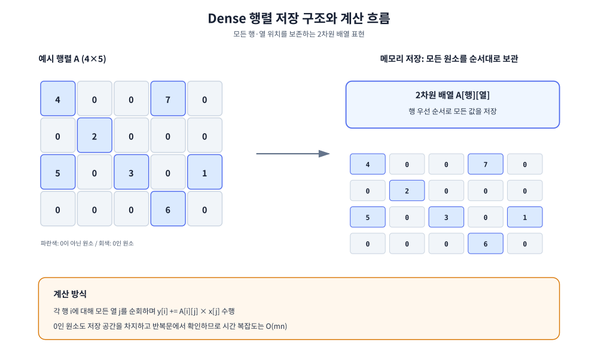
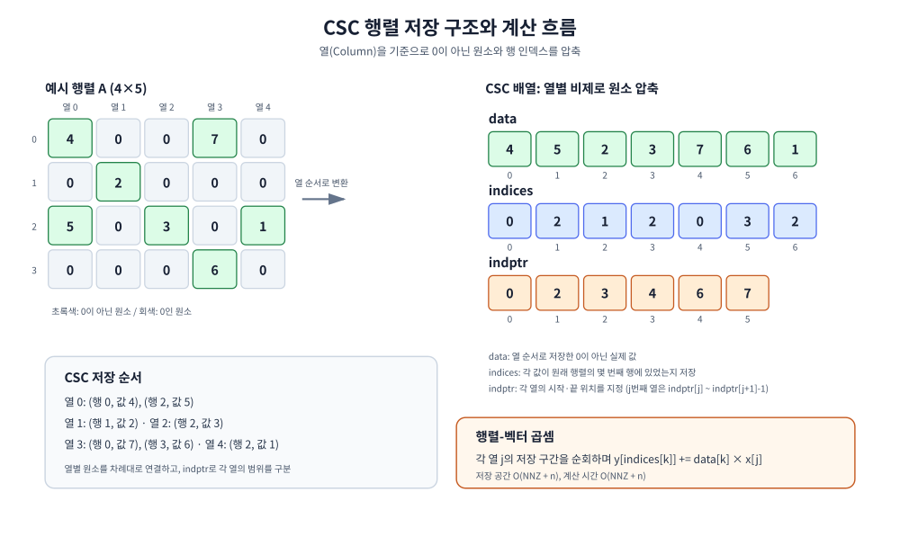
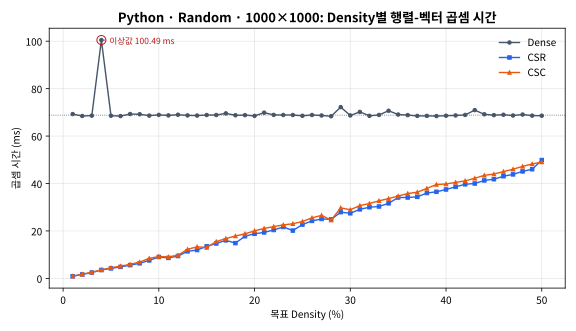
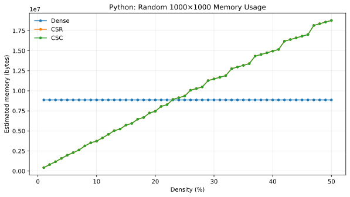
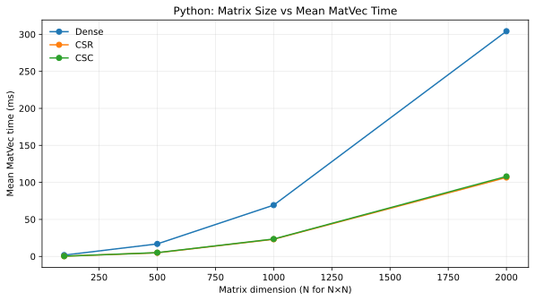
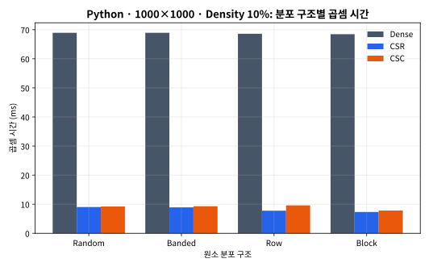

# 희소 행렬 저장 방식에 따른 행렬-벡터 곱셈 성능 비교
---

Github 저장소 링크 : https://github.com/2026193116/Algorithm-Project

## 1. 과제 개요

### 1.1 주제 선정 동기

평소 MATLAB을 사용하면서 행렬과 벡터를 활용하는 과제를 자주 수행하였다. 이 과정에서 컴퓨터가 행렬을 실제로 어떤 방식으로 저장하고 계산하는지 궁금해졌다. 특히 행렬에는 0인 원소가 많이 포함될 수 있는데, 이러한 원소까지 모두 메모리에 저장하고 곱셈 과정에서 확인하는 것이 효율적인지 의문이 들었다.그리고 이번 프로젝트를 진행하면서 희소 행렬(Sparse Matrix)이란 개념을 배우게 되었다. 희소 행렬은 전체 원소 중 0이 아닌 원소의 비율이 낮은 행렬로, 이를 계산할 때 0이 아닌 원소만 저장하는 자료구조를 사용하면 저장 공간과 연산량을 줄일 수 있을 것이라 생각했다. 정말 그런지 확인해보고자 일반적인 2차원 배열인 Dense, 행을 기준으로 압축하는 CSR(Compressed Sparse Row), 열을 기준으로 압축하는 CSC(Compressed Sparse Column)를 직접 구현하고, 같은 행렬-벡터 곱셈을 수행하여 성능을 비교하였다.

### 1.2 프로젝트 목표와 질문

핵심 연산은 다음과 같은 행렬-벡터 곱셈이다.

$$
y = Ax, \qquad A \in \mathbb{R}^{m \times n}, \quad x \in \mathbb{R}^{n}
$$

- 비교 대상 :
  - 행렬 저장 형식 : Dense, CSR(Compressed Sparse Row), CSC(Compressed Sparse Column)
  - 구현 언어 : C언어, Python
  - 핵심 연산 : 행렬-벡터 곱셈 $y=Ax$
  - 측정 항목 : 자료구조 변환 시간, 행렬-벡터 곱셈 시간, 메모리 사용량
- 공통 조건 :
  - 동일한 데이터(언어별) : 각 언어에서 생성한 하나의 행렬과 벡터를 Dense·CSR·CSC 세 저장 형식에 공통으로 사용한다. C와 Python 사이에서는 난수 생성기가 달라 원소의 위치와 값까지 동일하다고 보장하지 않는다. 또한 행렬 원소는 C에서 `double`, Python에서 `int`(1–10)로 저장되고 입력 벡터는 두 언어 모두 실수형이다.
  - 동일한 실험 조건: 행렬 크기, 목표 Density, 데이터 분포 구조 등 주요 실험 조건을 통일한다.
  - 데이터 생성의 재현성: 각 언어에서 Seed를 42로 고정하여 동일한 생성 환경 내에서 실험을 재현할 수 있도록 한다.
  - 동일한 검증 기준 : Dense의 계산 결과를 기준으로 CSR과 CSC의 연산 정확성을 검증한다. Python의 모든 실험과 C 기본 구조 실험(`main.c`)은 실행 중에 결과를 비교해 `valid`에 기록한다. C Density 실험(`main_density.c`)은 실행 중 비교를 하지 않으므로 `tools/verify_density.c`로 같은 조건을 재현해 따로 검증했다(4.4절).
  - 동일한 측정 기준 : 자료구조 변환 시간, 행렬-벡터 곱셈 시간, 메모리 사용량을 구분하여 측정 
- 핵심 질문 :
  - 희소도가 낮아질수록 CSR과 CSC의 계산 시간 및 메모리 사용량은 Dense와 얼마나 달라지는가?
  - 행렬 크기가 커질수록 세 저장 방식의 차이는 어떻게 변하는가?
  - 같은 저장 방식이라도 C와 Python 구현에서 성능 차이가 나타나는가?
  - 0이 아닌 원소가 Random, Banded, Row, Block 중 어떤 구조로 분포하는지에 따라 결과가 달라지는가?
  - 희소 형식으로 변환하는 데 드는 비용까지 포함하면 어느 방식이 유리한가?

### 1.3 비교 방식의 개요

- **Dense:** 모든 행렬 원소를 2차원 배열에 저장한다. 구현이 단순하지만 0도 저장하고 순회한다.
- **CSR:** 각 행의 0이 아닌 원소를 연속해서 저장한다. `data`, `indices`, `indptr`을 사용한다. `indices`는 열 번호, `indptr`은 행별 시작 위치이다 [1][2]. 이 보고서와 코드는 CSC에서도 같은 세 이름을 쓴다.
- **CSC:** 각 열의 0이 아닌 원소를 연속해서 저장한다. `data`, `indices`, `indptr`을 사용한다. 이때 `indices`는 행 번호, `indptr`은 열별 시작 위치이다 [1][3].

## 2. 구현 구조와 개별 파일 설명

### 2.1 전체 설계

프로젝트는 자료구조 구현, 데이터 생성, 벤치마크, 실행 진입점, 테스트, 결과 후처리를 분리하였다. 이 구조를 통해 알고리즘 구현을 수정하더라도 실험 실행 및 CSV 후처리 코드를 전부 바꾸지 않도록 하였다.

### 2.2 C언어 구현 파일

| 파일 | 역할과 작동 방식 |
|---|---|
| `src/dense.h`, `src/dense.c` | Dense 행렬-벡터 곱셈의 인터페이스와 구현을 담당한다. 바깥 반복문은 행을, 안쪽 반복문은 열을 순회하며 각 행의 내적을 `y[i]`에 누적한다. |
| `src/csr.h`, `src/csr.c` | CSR 구조체와 변환·계산·해제 함수를 제공한다. 먼저 비제로 원소 수를 세고 배열을 할당한 뒤, 행을 순회하며 값과 열 인덱스를 저장한다. `indptr[i]`와 `indptr[i+1]`이 i번째 행의 데이터 구간을 가리킨다. 계산할 때는 이 구간만 순회한다. |
| `src/csc.h`, `src/csc.c` | CSC 구조체와 변환·계산·해제 함수를 제공한다. 열을 먼저 순회하여 각 열의 비제로 값과 행 인덱스를 저장한다. 곱셈에서는 열 번호에 해당하는 `x[j]`를 곱하고, 저장된 행 인덱스의 결과 위치에 누적한다. |
| `src/data_generator.h`, `src/data_generator.c` | 행렬 구조 열거형, 생성 함수, 메모리 해제 함수를 정의한다. 목표 Density에 맞는 NNZ를 계산한 뒤 Random·Banded·Row·Block 구조에 맞는 후보 위치를 만들고, 그중 필요한 수만큼 선택해 1–10의 값을 배치한다. |
| `src/benchmark.h`, `src/benchmark.c` | 실행 시간과 메모리 사용량을 측정한다. 단조 증가 시계인 `CLOCK_MONOTONIC`을 사용하며, 7회 측정값의 중앙값을 반환한다. 곱셈 시간은 한 번의 측정마다 `1,000,000 ÷ 원소 수`번(최소 1, 최대 1,000) 반복해 평균낸 값 7개의 중앙값이다. 따라서 100×100은 100회, 500×500은 4회, 1000×1000 이상은 1회 반복이다. 변환 시간은 `dense_to_csr`·`dense_to_csc` 호출(내부 `malloc` 포함)만 재며, 임시 자료구조의 해제(`free`)는 측정 구간 밖이다. 변환에는 워밍업이 없고 7회 중앙값을 쓴다. 메모리 사용량은 측정이 아니라 `자료형 크기 × 원소 수`로 계산한 값이다. |
| `src/main.c` | 기본 구조 실험의 실행 진입점이다. 행렬·벡터 생성, Dense 계산, CSR·CSC 변환과 계산, 결과 검증, 벤치마크, CSV 저장 및 동적 메모리 해제를 순서대로 수행한다. |
| `src/main_density.c` | Density 심화 실험의 C 실행 진입점이다. 크기 100·500·1000·2000, Density 1–50%(1% 간격), 네 구조를 반복 실행하고 `c_density_results.csv`를 생성한다. 이 파일은 CSR·CSC 결과를 Dense와 비교하지 않으며 `valid`에는 시간 측정이 모두 성공했는지만 기록한다. 입력 벡터는 `rand() % 10 + 1`로 만든다(`main.c`는 `j % 5 + 1`). |

### 2.3 Python 구현 파일

| 파일 | 역할과 작동 방식 |
|---|---|
| `src/dense.py` | 리스트로 표현된 Dense 행렬의 각 행과 벡터의 내적을 계산한다. |
| `src/csr.py` | Dense 행렬을 행 단위로 읽어 `data`, `indices`, `indptr` 리스트를 만든다. `csr_matvec`은 `indptr`로 각 행의 구간을 찾아 비제로 원소만 계산한다. |
| `src/csc.py` | Dense 행렬을 열 단위로 읽어 CSC 배열을 만든다. `csc_matvec`은 열별 구간을 순회하고 해당 행의 결과에 곱을 누적한다. 결과 벡터의 길이를 정확히 유지하기 위해 행 개수 `m`을 인자로 받는다. |
| `src/data_generator.py` | `random.Random(seed)`를 사용해 행렬을 생성한다. `seed=42`를 기본값으로 두어 동일한 Python 조건에서 재현 가능한 입력을 만든다. 목표 NNZ는 C 구현과 같은 반올림 규칙으로 계산한다. |
| `src/benchmark.py` | `time.perf_counter()`로 연산 시간을 측정하고, 최초 1회는 워밍업으로 버린 뒤 20회 측정값의 중앙값을 사용한다. `sys.getsizeof()`를 재귀적으로 적용해 리스트와 그 내부 객체의 메모리 크기를 추정하며, 같은 객체(`id`)는 한 번만 센다(5.5절). |
| `src/main.py` | 기본 구조 실험을 실행한다. 크기 100·500·1000·2000, 대표 Density 1·5·10·30·50%, 네 구조를 조합하여 결과를 CSV에 기록한다. |
| `src/main_density.py` | Density를 1–50%까지 1% 간격으로 바꿔 심화 실험을 수행하고 `python_density_results.csv`를 만든다. 변환 시간은 워밍업 후 20회 반복한 중앙값으로 별도 기록하며, 변환 결과의 `del`은 측정 구간 밖이다. 입력 벡터는 `j % 5 + 1`이고, CSR·CSC 결과를 Dense와 비교해 `valid`에 기록한다(Dense 행은 기준이므로 항상 1). |

### 2.4 결과 통합·검증·시각화 파일

| 파일 | 역할과 작동 방식 |
|---|---|
| `src/merge_results.py` | C와 Python의 기본 구조 실험 CSV를 읽어 필수 열과 행 개수를 확인한 뒤 `combined_structure_results.csv`로 통합한다. |
| `src/merge_density_results.py` | Density 심화 실험의 C·Python CSV를 통합하여 `combined_density_results.csv`를 생성한다. 입력 언어와 필수 열, 언어별 결과 행 개수를 확인한다. |
| `src/validate_results.py` | Density 통합 결과의 데이터 수, 조건 누락·중복, Density와 NNZ 관계, 알고리즘 간 NNZ 일치, `valid` 값 등을 검사한다. 검증 요약을 텍스트 파일로 저장한다. `valid` 열이 정확성 비교를 뜻하는지는 언어·실험마다 다르므로(3.6절) 이 검사만으로 C Density 행의 정확성을 보증하지 않는다. |
| `src/plot_results.py` | 기본 구조 실험 CSV를 읽어 크기·Density·메모리·언어 비교 그래프를 생성한다. |
| `src/plot_density_results.py` | Density별 실행 시간·메모리·변환 비용 등을 분석하고 그래프 및 `density_crossover_summary.csv`를 생성한다. |
| `tests/test.c` | 직사각형 행렬, 전체가 0인 행렬, 네 가지 데이터 구조의 생성 및 NNZ를 검사한다. 계산 결과는 허용 오차를 두고 비교한다. |
| `tests/test.py` | Python 소스 구문, Dense·CSR·CSC 결과 일치, 영행렬 처리, 생성기 재현성 및 잘못된 입력 처리를 `unittest`로 검사한다. |
| `src/make_report_figures.py` | 통합 CSV에서 보고서의 결과 그래프 8개(SVG)를 만든다. 라벨은 한국어로 통일했고, 이상값은 지우지 않고 표시한다. |
| `tools/verify_density.c` | `main_density.c`와 같은 난수 순서로 행렬·벡터를 재현해 800개 조건 전체에서 CSR·CSC 결과가 Dense와 일치하는지 검사하고, 조건과 nnz가 `c_density_results.csv`와 같은지도 확인한다(4.4절). |
| `Makefile` | C 구문 검사와 C·Python 테스트 및 실행을 명령으로 묶는다. `make test`, `make run`, `make verify-density` 등을 제공한다. `src/`에 `main`이 둘(`main.c`, `main_density.c`)이므로 실험 실행 파일은 명시 규칙으로 필요한 파일만 링크한다. |

### 2.5 실험 실행 흐름

먼저 `make test`로 C 소스 구문과 C·Python 핵심 기능을 확인한다. 테스트가 통과하면 실행 프로그램이 행렬과 벡터를 생성한다. Python 실험과 C 기본 구조 실험은 Dense 계산을 기준 결과로 삼아 CSR·CSC 결과를 비교하고, 통과한 실험만 벤치마크 측정값과 함께 CSV로 저장한다. C Density 실험은 이 비교를 하지 않으므로 `tools/verify_density.c`로 따로 검증한다(4.4절). 이후 통합·검증 스크립트가 결과를 정리하고 그래프 스크립트가 PNG 그래프(`figures/`)를 생성한다. 보고서에 실린 SVG 그래프는 `src/make_report_figures.py`가 통합 CSV에서 만든다.

## 3. 코드 작동 원리

### 3.1 Dense 행렬-벡터 곱셈

Dense 구현은 가장 직관적인 기준 구현이다. 먼저 결과 벡터의 각 행 위치를 0으로 초기화한다. 이후 해당 행의 모든 열을 순회하며 `A[i][j]`와 `x[j]`의 곱을 결과에 누적한다. 따라서 0인 원소도 배열에 저장되어 있고 반복문에서 확인된다. 행렬 크기가 m×n이면 모든 원소를 순회하므로 시간 복잡도는 $O(mn)$이다.

### 3.2 CSR 변환과 계산

CSR 변환은 두 단계로 진행된다. 첫 번째 단계에서 전체 행렬을 확인해 0이 아닌 원소의 개수인 NNZ를 센다. 이 값을 이용해 `data`와 `indices`의 공간을 할당하고, 행 개수보다 하나 긴 `indptr`를 만든다. 두 번째 단계에서는 각 행을 왼쪽에서 오른쪽으로 순회하면서 0이 아닌 값은 `data`에, 열 번호는 `indices`에 기록한다. 각 행을 시작하기 전에 현재 저장 위치를 `indptr`에 기록하고 마지막에는 전체 NNZ를 마지막 포인터에 저장한다. 곱셈 단계에서는 i번째 행에 해당하는 `indptr[i]`부터 `indptr[i+1]` 직전까지 순회한다. 저장된 열 인덱스를 이용해 벡터의 해당 위치를 찾고 값과 곱해 `y[i]`에 누적한다. 행렬에 0이 아닌 원소가 NNZ개라면 계산은 주로 NNZ에 비례하며, 포인터 배열을 포함한 저장 공간은 $O(NNZ+m)$이다.

### 3.3 CSC 변환과 계산

CSC는 CSR의 행과 열을 바꾼 방식이다. 변환 시 열을 먼저 순회하며 0이 아닌 값을 `data`에, 해당 값이 위치한 행을 `indices`에 저장한다. `indptr[j]`와 `indptr[j+1]`은 j번째 열의 저장 구간을 나타낸다. 곱셈을 시작할 때 결과 벡터 전체를 0으로 초기화한다. 이후 각 열 j의 비제로 원소를 순회하면서 `data[k] * x[j]`를 해당 행 `indices[k]`에 누적한다. CSC에서는 0이 아닌 원소가 없는 행이 `indices`에 전혀 나타나지 않을 수 있으므로, 전체 행 개수를 인덱스 배열만으로 추론하지 않고 `rows`를 별도로 전달한다. 저장 공간은 $O(NNZ+n)$이다.

### 3.4 저장 방식별 행렬-벡터 곱셈 시간 복잡도 비교

세 가지 저장 방식은 행렬-벡터 곱셈을 수행하는 과정에서 서로 다른 시간 복잡도를 가진다.

| 저장 방식 | 시간 복잡도 | 계산 과정 |
|---|---|---|
| Dense | $O(mn)$ | 전체 행렬 원소를 순회하며 곱셈 수행 |
| CSR | $O(m+NNZ)$ | 결과 벡터 초기화 후 비제로 원소만 순회 |
| CSC | $O(m+NNZ)$ | 결과 벡터 초기화 후 비제로 원소만 순회하며 결과에 누적 |

Dense는 행렬의 모든 원소를 확인해야 하므로 행렬 크기가 $m\times n$일 때 $O(mn)$의 시간이 필요하다. 반면 CSR과 CSC는 결과 벡터를 먼저 0으로 초기화하는 과정에서 $O(m)$의 시간이 소요되고, 이후 0이 아닌 원소만 순회하므로 $O(NNZ)$의 시간이 추가된다. 따라서 전체 시간 복잡도는 $O(m+NNZ)$로 표현할 수 있다. 이를 통해 행렬의 크기가 같더라도 비제로 원소의 개수가 적은 희소 행렬에서는 CSR과 CSC가 Dense보다 적은 연산으로 행렬-벡터 곱셈을 수행할 수 있음을 알 수 있다. 다만 실제 실행 시간은 저장 방식뿐 아니라 자료구조 접근 방식과 구현 언어에도 영향을 받는다.

### 3.5 데이터 생성 방식과 Density

Density(0이 아닌 원소 밀도)는 전체 행렬 원소 중 0이 아닌 원소가 차지하는 비율을 의미한다. Density가 낮을수록 0인 원소가 많아지므로 일반적으로 희소 행렬 저장 방식이 유리해질 가능성이 높다.

$$
\text{Density} = \frac{NNZ}{m \times n} 
$$

여기서 NNZ는 0이 아닌 원소의 개수이며, m과 n은 각각 행과 열의 개수이다. 계산 결과는 0–1 사이의 비율로 나타나며, 백분율로 표현할 때는 100을 곱한다.

$$
\text{Density} = \frac{NNZ}{m \times n} \times 100
$$

데이터 생성기는 목표 Density로부터 NNZ를 반올림하여 계산한 뒤, 해당 개수만큼 비제로 위치를 선정하며, 0이 아닌 값은 1–10 범위에서 생성하도록 설계하였다.

행렬을 생성할 때는 네 가지 분포 구조를 사용하였다.

- **Random:** 전체 행렬 위치를 후보로 하여 0이 아닌 원소의 위치를 선택
- **Banded:** 주대각선 주변의 제한된 폭 안에서 후보 위치를 선택
- **Row:** 위쪽의 일부 행에 원소가 집중되도록 후보 위치를 구성
- **Block:** 행렬의 일부 영역에 원소가 모이도록 후보 위치를 구성

Python 생성기는 행렬을 만들 때마다 `random.Random(42)`를 새로 만들므로 조건 하나만 따로 실행해도 같은 행렬이 나온다. 반면 C는 실행 진입점에서 `srand(42)`를 한 번만 호출하므로 각 행렬이 실행 순서(크기 → Density → 구조)에 의존한다. 즉 C 결과의 재현은 전체 실험을 같은 순서로 실행할 때만 보장된다. 다만 C와 Python의 난수 생성 알고리즘은 서로 다르므로, 시드 숫자가 같다고 해서 두 언어에서 0이 아닌 원소의 위치와 값이 동일해진다고 볼 수 없기 때문에, 실제 검증 파일에도 이 차이를 추가 확인 사항으로 기록하였다.

### 3.6 측정 기준

| 항목 | 의미 | 해석 시 유의점 |
|---|---|---|
| `conversion_ms` | Dense에서 CSR 또는 CSC로 변환하는 데 걸린 시간 | Dense는 원래 표현이므로 0으로 기록한다. 메모리 할당 시간은 포함하고 해제 시간은 포함하지 않는다. |
| `matvec_ms` | 해당 표현으로 행렬-벡터 곱셈을 수행한 시간 | 변환 비용을 포함하지 않은 계산 시간이다. |
| `memory_bytes` | 해당 표현을 저장하는 데 필요한 메모리 추정치 | C는 계산식(자료형 크기 × 원소 수), Python은 `sys.getsizeof` 합이라 언어 간 절대값 비교에 주의한다(5.5절). |
| `nnz` | 0이 아닌 원소 개수 | 같은 실험 조건의 세 알고리즘에서 동일해야 한다. |
| `actual_density` | 실제 NNZ를 이용해 계산한 Density(비제로 원소 밀도) | 0–1 사이의 비율로 저장하며, 목표 Density와 일치하는지 검증한다. |
| `valid` | Python 전 실험과 C 기본 구조 실험에서는 CSR·CSC 결과가 Dense 기준 결과와 일치하는지 여부이다. **C Density 실험에서는 모든 시간 측정이 성공했는지 여부이다.** | 1은 위 의미에서의 통과이다. C Density 실험의 정확성은 4.4절의 별도 검증으로 확인했다. |

C 벤치마크는 `CLOCK_MONOTONIC`을 사용해 7회 측정한 중앙값을 기록하고, 행렬 크기에 따라 반복 횟수를 조정하며 Python 벤치마크는 `time.perf_counter()`를 사용해 20회 측정한 중앙값을 기록한다. 따라서 C와 Python의 절대 실행 시간은 각 언어의 구현 및 측정 방식 차이를 고려하여 해석하였다.

## 4. 실험 설계와 진행 과정

### 4.1 기본 구조 실험

기본 실험에서는 행렬 크기 100, 500, 1000, 2000과 대표 Density 1%, 5%, 10%, 30%, 50%를 사용하였다. Random, Banded, Row, Block 네 가지 구조를 조합하고 Dense, CSR, CSC의 결과를 측정하였다. 기본 통합 CSV에는 C 240행, Python 240행으로 총 480행이 기록되어 있다.

### 4.2 Density 심화 실험

기본 실험 이후 Density 변화에 따른 성능의 변화를 더 세밀하게 관찰하기 위해 1%부터 50%까지 1% 간격으로 실험 범위를 확장하였다. 크기 네 종류, 구조 네 종류, Density 50개, 알고리즘 세 종류를 언어별로 실행하여 언어당 2,400행, 총 4,800행을 생성하였다. 기본 실험과 심화 실험의 실행 파일 및 결과 파일을 구분하여 기존 결과가 덮어써지지 않도록 관리하였다. 기본 실험은 `main.c`, `main.py`를 사용하고, Density 실험은 `main_density.c`, `main_density.py`를 사용한다. 결과도 `*_structure_results.csv`와 `*_density_results.csv`로 나누어 저장한다.

### 4.3 검증 과정

C와 Python의 개별 결과를 통합한 뒤 `validate_results.py`로 다음 항목을 검사하였다.

1. 전체 데이터가 4,800행이며 C와 Python이 각각 2,400행인지 확인한다.
2. 네 가지 구조별 데이터 개수가 언어마다 600행인지 확인한다.
3. 크기·Density·구조별 조건이 누락되지 않았는지 확인한다.
4. 모든 행에서 `valid=1`인지 확인한다. 단, C Density 행의 `valid`는 정확성 비교가 아니라 측정 성공 여부이다(3.6절).
5. `actual_density = nnz / (rows × cols)` 관계와 목표 Density에 따른 NNZ 반올림 값이 일치하는지 확인한다.
6. 같은 실험 조건에서 Dense·CSR·CSC의 NNZ와 실제 Density가 일치하는지 확인한다.
7. 중복 실험 데이터가 없는지 확인한다.

검증 결과는 `report/density_validation_summary.txt`에 저장되어 있으며, 기록된 오류 항목은 없다. 단, C와 Python의 난수 생성 방식 차이, CSV에 행렬 원본이 저장되지 않은 점, 메모리 측정 기준 차이는 경고 항목으로 남아 있다.

### 4.4 C Density 실험의 정확성 재검증

`main_density.c`는 Dense와 CSR·CSC 결과를 비교하지 않는다. 따라서 `validate_results.py`가 확인하는 'valid=1'은 C Density 2,400행의 정확성 근거가 될 수 없다. 이를 보완하려고 `tools/verify_density.c`(`make verify-density`)를 작성했다. 이 프로그램은 `main_density.c`와 같은 순서로 `srand(42)`, 행렬 생성, 입력 벡터(`rand() % 10 + 1`) 생성을 되풀이해 800개 조건에서 CSR·CSC 곱셈 결과가 Dense 결과와 허용 오차 $10^{-9}$ 이내로 일치하는지 비교하고, 재현한 조건과 nnz가 `c_density_results.csv`의 2,400행과 같은 순서로 일치하는지도 검사한다.

| 검사 | 결과 |
|---|---|
| 검사한 조건 수 | 800 (크기 4 × Density 50 × 구조 4) |
| CSR·CSC와 Dense의 결과 불일치 | 0건 |
| CSV와 조건·nnz 불일치 | 0건 (2,400행) |

실험 프로그램(`main_density.c`)은 수정하지 않았으므로 CSV는 제출한 코드가 만든 그대로이다. 행렬과 벡터의 원소가 작은 정수이므로 합산 순서가 달라도 부동소수점 오차가 생기지 않는다. 이 재현은 같은 환경(`rand()` 구현)에서 성립한다.

### 4.5 실험 환경과 측정의 한계

| 항목 | 내용 |
|---|---|
| 실행 환경 | Docker 컨테이너(`debian:trixie-slim` |
| C 컴파일러 | gcc 14.2, `-std=c17 -Wall -Wextra -O2` |
| Python | 3.13, 표준 라이브러리 + 그래프용 `matplotlib` |
| CPU · 메모리 · 호스트 OS | CPU: Intel Core Ultra 7 256V (8코어) / RAM: 16GB / 호스트 OS: Windows 11 Home (25H2) |

이 실험의 결과를 읽을 때 다음 한계를 전제한다.

1. **조건마다 행렬은 하나이다.** 시드 42로 만든 행렬 하나에서 시간을 반복해 측정했을 뿐, 서로 다른 행렬에 대한 분산은 재지 않았다.
2. **단일 측정 이상값이 있다.** Dense 곱셈은 Density와 무관하게 연산량이 같으므로, 같은 (구조, 크기) 시리즈의 Density 1–50% 중앙값보다 1.2배를 넘는 Dense 값을 이상값으로 정의해 세어 보았다. C는 800개 중 74개(9.3%), Python은 800개 중 89개(11.1%)였고, 대부분 시간이 짧은 100×100에 몰려 있다(C 45/200, Python 79/200). 1000×1000 이상에서는 C 10/400, Python 1/400이다. 원인은 확인하지 않았으며 단일 측정에서 흔한 외란(다른 프로세스, 스케줄링, 클럭 변화)과 짧은 시간의 타이머·인터프리터 워밍업이 후보이다. 이상값은 제거하지 않고 그대로 두었다.
3. **그래서 해석은 경향과 중앙값 중심으로 한다.** 개별 지점 하나의 차이(예: 한 Density에서 CSR과 CSC의 차이)는 일반화하지 않는다.
4. **C와 Python의 입력과 측정 기준이 다르다.** 행렬 값의 자료형, 입력 벡터, 반복 횟수, 메모리 계산 방식이 다르므로 언어 간 절대값 비교는 하지 않는다(5.5절, 5.8절).
5. **C의 난수는 실행 순서에 의존한다**(3.5절).

### 4.6 프로젝트 진행 과정

프로젝트는 MATLAB 사용 경험에서 출발한 질문을 구체적인 비교 문제로 바꾸는 것부터 시작하였다. 먼저 Dense 방식으로 기준 계산을 만들고, CSR과 CSC의 자료구조를 직접 구성하여 같은 행렬-벡터 곱셈을 구현하였다. 초기에는 작은 직사각형 행렬과 전체가 0인 행렬을 이용해 결과가 일치하는지 확인하였다. 이후 C와 Python으로 데이터 생성기와 벤치마크를 확장하였다. 실험 조건이 늘어나면서 행렬 크기, Density, 구조를 일정한 목록으로 관리하고, 실행 파일과 CSV 결과를 기본 실험 및 심화 실험으로 분리하였다. C와 Python 결과를 합치는 스크립트, 통합 데이터 검증 스크립트, 그래프 생성 스크립트를 추가하여 실험 결과를 반복해서 확인할 수 있는 흐름을 만들었다. 마지막으로 Density를 1% 간격으로 확장해 4,800행의 데이터를 생성하고, 검증 요약과 교차점 분석 CSV를 통해 저장 공간 및 변환 비용을 포함한 결과를 확인하였다.

## 5. 실험 결과

### 5.1 결과 데이터 개요

| 실험 | 행렬 크기 | Density | 구조 | 언어 | 결과 행 수 |
|---|---|---|---|---|---:|
| 기본 구조 실험 | 100, 500, 1000, 2000 | 1, 5, 10, 30, 50% | 4종 | C, Python | 480 |
| Density 심화 실험 | 100, 500, 1000, 2000 | 1–50%, 1% 간격 | 4종 | C, Python | 4,800 |

Density 심화 실험의 통합 CSV를 기준으로 결과를 분석하였다. 아래의 Density별 그래프는 별도 조건을 명확히 비교하기 위해 Random 구조의 1000×1000 행렬을 선택하였다. 별도 언급이 없는 실행 시간은 CSV에 기록된 각 조건의 반복 측정 중앙값이다. 모든 결과 그래프는 `src/make_report_figures.py`로 통합 CSV에서 만들었고, 빨간 원은 4.5절의 기준에 따른 Dense 이상값 표시이다.

### 5.2 C언어 구현: Density에 따른 계산 시간

C 구현에서 1000×1000 Random 행렬의 Density가 10%일 때 Dense의 행렬-벡터 곱셈 시간은 약 0.930 ms, CSR은 약 0.077 ms, CSC는 약 0.115 ms였다. Dense는 100만 개의 원소를 모두 확인하지만, CSR과 CSC는 10만 개의 비제로 원소를 중심으로 계산하므로 곱셈 단계에서는 희소 형식이 더 짧은 시간이 걸렸다. 이는 Dense의 시간 복잡도인 O(mn)과 CSR·CSC의 O(m+NNZ)가 실제 측정 경향으로 나타난 사례이다. C의 Dense는 Density 1–50%에서 중앙값 0.94 ms(사분위 0.92–0.98 ms)로 거의 일정했지만, 9%에서 2.51 ms, 42%에서 1.28 ms의 이상값이 있다(그림의 빨간 원). 이 조건은 한 번의 측정이 1회 반복이라 외란에 민감하며 원인은 확인하지 않았다. 이상값은 제거하지 않았고 Dense의 대표값은 중앙값으로 읽는다. Density가 1%일 때 CSR과 CSC의 곱셈 시간은 각각 약 0.006 ms, 0.012 ms로 더 짧았다. 반면 Density가 50%가 되면 CSR은 약 0.459 ms, CSC는 약 0.363 ms로 증가하였다. 비제로 원소가 많아질수록 희소 형식이 순회해야 하는 항목도 증가하기 때문이다. 이 조건에서도 Dense의 약 0.927 ms보다는 짧았지만, Density가 높아질수록 희소 형식의 시간상 이점은 줄어드는 모습을 보였다. CSR과 CSC 중 어느 쪽이 더 빠른지는 Density에 따라 고정되지 않았다. 50개 Density 지점 중 CSR이 더 짧은 곳은 15개뿐이고 CSC가 35개에서 더 짧았다(1–9%: CSR 6/9, 10–30%: CSR 5/21, 31–50%: CSR 4/20). 10%나 30%처럼 보고서에서 예로 든 지점은 CSR이 빨랐지만(10%: 0.077 ms 대 0.115 ms) 그 구간 전체의 경향은 아니다. 두 방식의 차이는 중앙값으로 약 20%, 절대값으로는 최대 0.14 ms이다. CSR은 행별 구간을 순회하며 한 결과 원소에 누적하고, CSC는 열별 구간을 순회하며 여러 결과 위치에 누적한다. 이처럼 메모리 접근과 누적 방식이 다르므로 실제 성능은 자료구조의 순회 방향과 데이터 배치, 측정 환경에 따라 달라질 수 있다.

### 5.3 Python 구현: Density에 따른 계산 시간

Python 구현에서도 Density가 낮을 때 CSR과 CSC의 행렬-벡터 곱셈 시간이 Dense보다 짧게 나타났다. Python의 Dense는 Density 1–50%에서 중앙값 68.8 ms(사분위 68.6–69.1 ms)로 거의 일정했고, 4%에서만 100.5 ms의 이상값이 있다(그림의 빨간 원). 이 한 점을 빼면 범위는 68.4–72.2 ms이다. 1000×1000 Random 행렬의 Density가 1%일 때 Dense는 약 69.28 ms였지만 CSR은 약 0.89 ms, CSC는 약 0.95 ms였다. Density 10%에서는 Dense 약 68.93 ms, CSR 약 9.03 ms, CSC 약 9.21 ms였다. 즉, 비제로 원소만 순회하는 희소 형식은 0인 원소가 많은 조건에서 계산 대상 자체를 크게 줄일 수 있었다. Density가 50%가 되면 CSR은 약 49.88 ms, CSC는 약 49.06 ms까지 증가하였다. 반면 Dense는 약 68.59 ms로 큰 폭의 변화가 없었다. Dense는 Density와 관계없이 전체 100만 원소를 모두 순회하기 때문에 계산량이 거의 일정하다. CSR과 CSC는 NNZ가 증가할수록 실제 순회 항목이 많아지므로 실행 시간도 증가한다. 따라서 Python 결과는 이론적인 O(mn)과 O(m+NNZ)의 차이를 잘 보여준다. 다만 실제 시간에는 Python 반복문과 리스트 접근에 따른 실행 비용도 함께 포함된다. 이 결과에서 CSR과 CSC의 상대적인 우위도 Density에 따라 달라졌다. 50개 Density 지점 중 47개에서 CSR의 곱셈 시간이 조금 더 짧았고(1–9%: 9/9, 10–30%: 19/21, 31–50%: 19/20) 50%에서는 CSC가 근소하게 짧았다. 두 방식의 차이는 중앙값으로 약 5%이다. 차이가 크지 않은 구간도 있으므로 한 조건의 결과만으로 한 형식이 항상 우수하다고 일반화해서는 안 된다.

### 5.4 행렬 크기에 따른 계산 시간 변화

두 그래프는 같은 조건(Random 구조, Density 10%)에서 크기만 100, 500, 1000, 2000으로 바꾼 값이다. 아래 표는 같은 값이며 단위는 ms이다.

| 언어 | 방식 | 100 | 500 | 1000 | 2000 | 기울기(100→2000) | 기울기(1000→2000) |
|---|---|---:|---:|---:|---:|---:|---:|
| C | Dense | 0.0076 | 0.2253 | 0.9300 | 3.8089 | 2.08 | 2.03 |
| C | CSR | 0.0006 | 0.0180 | 0.0767 | 0.3534 | 2.13 | 2.20 |
| C | CSC | 0.0008 | 0.0299 | 0.1154 | 0.3232 | 2.00 | 1.49 |
| Python | Dense | 1.22 | 16.39 | 68.93 | 288.27 | 1.82 | 2.06 |
| Python | CSR | 0.13 | 1.92 | 9.03 | 39.12 | 1.91 | 2.12 |
| Python | CSC | 0.13 | 2.05 | 9.21 | 41.63 | 1.93 | 2.18 |

시간이 $T \propto n^p$를 따른다고 보고 양 끝점의 로그 기울기 $p$를 구했다. **세 방식 모두 $p$가 약 2**이다. 이론과 맞는다. Dense는 $O(mn)=O(n^2)$이다. CSR·CSC는 $O(m+NNZ)$인데 Density가 고정이면 $NNZ=d\,n^2$이라 $n^2$항이 지배한다. 따라서 크기를 키워도 희소 형식의 이점은 비율로는 거의 유지된다. 2000×2000에서 Dense 시간을 CSR 시간으로 나눈 값은 C 10.8배, Python 7.4배이다.

이론과 어긋나는 지점도 있다.

- **Python Dense는 기울기가 1.82로 2보다 작다.** 원소당 비용이 100×100에서 약 122 ns, 2000×2000에서 약 72 ns였다. 작은 행렬에서 호출당 고정 비용(입력 검사, 인터프리터 워밍업)이나 측정 오차가 상대적으로 커진 결과로 보이며, 4.5절처럼 100×100에 이상값이 몰려 있다는 점과도 맞는다. 다만 이 원인을 분리해 검증하지는 않았다.
- **C CSC는 1000→2000의 기울기가 1.49로 낮고, 2000×2000에서는 CSC(0.323 ms)가 CSR(0.353 ms)보다 짧다.** 이 조건은 단일 측정이라 원인을 분리하지 못했고 일반화하지 않는다.

### 5.5 메모리 사용량 비교

C의 1000×1000 Random 행렬, Density 10%에서 Dense는 8,008,000 bytes, CSR과 CSC는 각각 1,204,004 bytes로 계산되었다. C 구현은 실제 측정이 아니라 식으로 구한다. Dense는 $8n^2+8n$ (원소 `double`과 행 포인터), CSR은 $12\,NNZ+4(m+1)$ (`double` 8 B + `int` 4 B), CSC는 $12\,NNZ+4(n+1)$이다. 위 값은 이 식에 $n=1000$, $NNZ=100{,}000$을 넣은 결과와 같다. 따라서 같은 행렬 크기와 NNZ라면 원소가 어느 위치에 분포하는지와 관계없이 CSR·CSC의 배열 크기는 동일하다. 같은 조건의 Python에서는 Dense가 8,865,164 bytes, CSR이 3,728,824 bytes, CSC가 3,729,020 bytes였다. Python의 희소 형식도 Dense보다 메모리를 적게 사용했지만, C에서 나타난 감소 폭만큼 크지는 않았다. 이는 Python 측정이 리스트 자체뿐 아니라 내부 객체의 크기와 참조 구조에 따른 오버헤드를 포함하기 때문이다. Python의 `data`, `indices`, `indptr`는 단순한 고정 폭 숫자 배열이 아니라 Python 객체를 담는 리스트이므로 원소 하나를 표현하는 데 추가 공간이 필요하다. Python 수치가 구조마다 크게 다른 이유도 계산으로 설명된다. 1000×1000, Density 10%에서 세 리스트 자체의 크기는 구조와 무관하게 1,610,824 bytes로 같다. 나머지는 정수 객체(28 B)의 합이다. 이때 CPython은 −5~256의 정수를 캐시해 하나의 객체를 공유하고, `get_memory_size`는 `id`가 같은 객체를 한 번만 센다. 그래서 `indices`에 담긴 값이 256 이하이면 몇 개의 객체로 계산되고, 256을 넘으면 원소마다 새 객체가 생겨 모두 계산된다. 프로젝트의 `get_memory_size`를 그대로 돌려 보면 다음과 같이 CSV의 값을 그대로 재현한다.

| 구조 | 형식 | `indices`의 서로 다른 객체 수 | 메모리 (bytes) |
|---|---|---:|---:|
| Random | CSR | 74,642 | 3,728,824 |
| Row | CSR (열 번호, 최대 999) | 74,557 | 3,726,500 |
| Row | CSC (행 번호, 0–99) | 100 | 1,641,704 |
| Block | CSR (열 번호, 0–315) | 18,928 | 2,168,888 |

즉 Row 구조에서 CSC(1.64 MB)가 CSR(3.73 MB)보다 작은 것은 '행이 상단에 몰려 행 번호가 모두 작은 정수 캐시 범위에 들어가 객체가 공유되기 때문'이다. 이는 CSR·CSC라는 형식 자체의 효율 차이가 아니라 Python이 작은 정수를 공유하는 객체 표현의 영향이다(C의 계산식은 값의 크기와 무관하다). 따라서 Python 메모리 수치는 정수 객체 오버헤드와 작은 정수 캐시의 영향을 포함한 값으로 읽는다. Density가 증가하면 CSR·CSC에 저장되는 비제로 값과 인덱스의 수가 증가하므로 메모리 사용량도 증가한다. Dense는 0인 원소까지 모두 저장하므로 Density와 무관하게 거의 일정하다. 이 차이는 희소 형식이 낮은 Density에서 저장 공간을 줄이는 이유를 보여준다. 다만 C와 Python의 메모리 측정 기준이 서로 다르므로 두 언어의 bytes 수치를 직접적인 메모리 효율 비교로 해석해서는 안 된다.

### 5.6 변환 비용을 포함한 전체 실행 시간

희소 형식은 Dense 행렬을 CSR 또는 CSC로 변환하는 시간이 추가되므로 곱셈 시간만으로 최종적인 유불리를 판단할 수 없다. 본 보고서에서는 한 번 변환한 뒤 한 번 곱셈을 수행하는 경우를 `total_ms = conversion_ms + matvec_ms`로 비교하였다. C 구현의 Density 교차점 분석에서는 4가지 구조와 4가지 행렬 크기 모두에서 관측한 Density 1–50% 범위 내에 CSR·CSC의 `total_ms`가 Dense보다 짧아지는 교차점이 나타나지 않았다. 예를 들어 Random 1000×1000, Density 10%에서 CSR의 변환 시간은 약 3.679 ms이고 곱셈 시간은 약 0.077 ms이다. 두 시간을 합한 약 3.756 ms는 Dense의 약 0.930 ms보다 길다. 즉, C에서는 희소 형식의 곱셈 자체는 빠르더라도 Dense 행렬을 압축 형식으로 만드는 초기 비용이 한 번의 곱셈에서 얻는 이점을 상쇄하였다. C의 1,600개 지점(구조 4 × 크기 4 × 방식 2 × Density 50) 가운데 CSR·CSC의 `total_ms`가 Dense보다 짧은 곳은 2개뿐이었다. 둘 모두 Banded 100×100, Density 28%에서 Dense가 평소(약 0.009 ms)의 3배인 0.027 ms로 튄 이상값 때문이며, 이를 제외하면 모든 지점에서 Dense가 유리했다. 변환 시간도 방식마다 다르다. C의 CSC 변환은 CSR 변환보다 느리고, Density 1–50% 중앙값 기준 CSC/CSR 비가 100×100 1.05, 500×500 1.08, 1000×1000 1.11, 2000×2000 1.35로 커진다(Python은 1.05, 1.14, 1.18, 1.29). 크기가 커질수록 격차가 커지는 이 경향은 CSC 변환이 행 우선(row-major)으로 저장된 배열을 열 방향으로 훑어 캐시 효율이 떨어진다는 가설과 일치한다. 다만 이 가설을 분리해 검증하는 실험은 하지 않았다. Python에서는 모든 구조·크기 조합에서 관측 범위 안에 `total_ms`의 교차점이 나타났다. 여기서 교차점은 Density가 증가함에 따라 희소 형식이 유리한 구간에서 Dense가 유리한 구간으로 바뀌는 경계를 의미한다. Random 1000×1000 조건에서는 CSR의 추정 교차 Density가 약 24.98%, CSC는 약 18.37%였다. 따라서 이 조건에서는 교차점보다 낮은 Density에서 변환과 한 번의 곱셈을 합한 희소 형식의 시간이 Dense보다 짧고, 교차점보다 높은 Density에서는 Dense가 더 짧아지는 것으로 분석되었다. 이 값은 1% 간격으로 측정한 결과 사이를 보간한 추정치이므로 보편적인 임계값이 아니라 해당 실험 조건에 한정된 값이다. Python Random 1000×1000, Density 10%를 예로 들면 CSR 변환은 약 38.865 ms, 곱셈은 약 9.029 ms로 합계는 약 47.894 ms이다. 이는 Dense 곱셈 약 68.932 ms보다 짧다. 반면 Density 50%에서는 CSR 변환과 곱셈의 합이 약 109.256 ms가 되어 Dense보다 길어진다. Density가 커질수록 저장할 비제로 원소와 인덱스가 늘어나 변환과 계산에 필요한 작업이 증가하기 때문이다. 이 차이는 C와 Python에서 희소 형식의 장점이 나타나는 조건이 다를 수 있음을 보여준다. 다만 이는 본 프로젝트에서 작성한 구현과 측정 방식에 대한 결과이다. C와 Python은 반복 측정 횟수와 메모리 표현이 다르고, 생성된 행렬과 벡터도 완전히 동일하지 않으므로 이를 모든 C 프로그램과 Python 프로그램에 적용되는 일반적인 성능 법칙으로 해석해서는 안 된다.

동일한 행렬을 여러 번 곱셈에 재사용한다면 변환 비용은 최초 한 번만 발생한다. 반복 횟수를 k라고 할 때 CSR의 전체 시간은 다음과 같다.

$$
T_{CSR}(k)=T_{conversion}+k\times T_{matvec}
$$

CSC도 같은 형태이며, Dense는 별도의 변환 없이 곱셈을 반복한다. 따라서 반복 횟수가 늘어나면 최초 변환 비용이 전체 시간에서 차지하는 비율이 감소한다. 이번 실험의 `total_ms`는 한 번의 곱셈을 가정한 비교이므로, 반복 연산 환경에서는 저장 방식의 유불리가 달라질 수 있다.

### 5.7 원소 분포 구조에 따른 차이

Random, Banded, Row, Block은 같은 Density라도 비제로 원소가 위치하는 방식이 다르다. C의 경우 1000×1000, Density 10%에서 Dense의 곱셈 시간은 구조별로 약 0.93–0.98 ms 범위였고, CSR은 약 0.074–0.096 ms, CSC는 약 0.072–0.115 ms 범위였다. 같은 NNZ라면 이론적으로 처리하는 비제로 원소 수는 같지만, 실제 실행 시간은 메모리 접근 순서와 누적 위치 등 구현상의 차이에 따라 달라질 수 있다. Python에서도 같은 조건에서 Dense는 약 68.4–68.9 ms로 비슷했지만, CSR과 CSC의 시간은 구조에 따라 차이가 나타났다. 예를 들어 Block 구조에서는 CSR 약 7.32 ms, CSC 약 7.82 ms였고, Row 구조에서는 CSR 약 7.77 ms, CSC 약 9.60 ms였다. 다만 이 차이를 원소가 모여 있는 모양 하나만의 효과라고 단정할 수는 없다. Python 리스트의 구성, 변환 과정, 메모리 접근 패턴과 측정 변동이 함께 영향을 미칠 수 있다. Python의 메모리 측정값도 구조에 따라 차이가 나타났다. 1000×1000, Density 10%에서 Row 구조의 CSC는 약 1,641,704 bytes였지만 CSR은 약 3,726,500 bytes였고, Block 구조의 CSR은 약 2,168,888 bytes였다. 5.5절에서 보인 것처럼 이 차이는 `indices`에 담긴 정수 값이 작은 정수 캐시(−5~256) 범위에 드는지에 따른 Python 객체 표현의 결과이다. 같은 NNZ라면 구조가 형식 자체의 저장 공간에 주는 영향은 C의 계산식처럼 같다.

### 5.8 C와 Python 결과를 함께 해석할 때의 주의점

두 언어 모두 Dense는 전체 원소를 순회하고 CSR·CSC는 비제로 원소 중심으로 계산한다는 공통적인 이론적 경향을 보였다. 그러나 실행 시간의 절대값은 직접 비교하기 어렵다. C 벤치마크는 `CLOCK_MONOTONIC`으로 7회 측정한 중앙값을 사용하고, Python은 `time.perf_counter()`로 20회 측정한 중앙값을 사용한다. 또한 C는 고정 폭 자료형의 배열을 사용하지만 Python은 객체와 리스트를 사용한다. 입력 데이터도 완전히 같지는 않다. 두 구현에서 Seed를 42로 고정했지만 C와 Python의 난수 생성 알고리즘이 서로 다르며, Density 실험에서 입력 벡터 생성 방식도 다르다. 행렬 값도 C는 `double`, Python은 `int`이고 C의 난수는 실행 순서에 의존한다(3.5절). 따라서 언어별 실행 시간의 배수 차이를 언어 자체의 성능 차이로 단정하기보다는, 각 구현 내부에서 Dense·CSR·CSC가 보이는 상대적인 경향과 변환 비용의 영향을 중심으로 해석하였다.

## 6. 결과 해석과 이론적 분석

### 6.1 방식별 장단점

| 방식 | 장점 | 단점 | 적합한 상황 |
|---|---|---|---|
| Dense | 구현과 인덱싱이 단순하고 변환 과정이 필요 없다. | 0도 저장하고 순회하므로 희소 행렬에서 낭비가 발생한다. | 밀도가 높거나 변환 비용을 피해야 하는 경우 |
| CSR | 행별 0이 아닌 원소만 순회하여 행 단위 계산에 적합하다. | 행렬 변환이 필요하고 행 단위 구조에 맞춘 접근이다. | 희소 행렬의 행별 연산 및 반복 계산 |
| CSC | 열별 0이 아닌 원소만 순회하고 열 단위 연산에 적합하다. | 변환 비용이 발생하고 결과 벡터에 누적하는 형태다. | 열 기준 접근이나 열 단위 연산이 중요한 경우 |

### 6.2 시간 복잡도와 실험 결과의 연결

Dense 행렬-벡터 곱셈은 m×n개의 원소를 모두 확인하므로 시간 복잡도가 O(mn)이다. CSR과 CSC는 결과 벡터를 초기화하는 O(m) 작업 이후 NNZ개의 비제로 원소를 처리하므로 O(m+NNZ)의 시간이 필요하다. 따라서 Density가 낮아 NNZ가 작을수록 희소 형식이 계산해야 할 항목 수가 줄어든다. C와 Python 모두 낮은 Density에서 CSR·CSC의 `matvec_ms`가 Dense보다 짧게 나타난 것은 이 이론과 일치한다. 반대로 Density가 증가하면 NNZ가 증가하여 CSR·CSC의 순회량이 커진다. Dense는 Density와 관계없이 전체 행렬을 순회하므로 실행 시간이 비교적 일정하게 유지된다. Python Random 1000×1000 결과에서 Dense는 Density 1–50% 동안 중앙값 68.8 ms(사분위 68.6–69.1 ms)로 거의 일정했지만(4%의 이상값 100.5 ms 제외 시 68.4–72.2 ms) CSR은 약 0.89 ms에서 약 49.88 ms로 증가하였다. 이는 전체 원소 수는 고정되어 있는 반면 희소 형식이 처리하는 비제로 원소 수는 Density에 비례해 증가하기 때문이다. 크기를 키운 실험에서도 세 방식의 로그 기울기가 모두 약 2로 이론과 맞았다(5.4절).

### 6.3 C언어 결과가 나타난 이유

C에서는 CSR·CSC의 곱셈 시간이 Dense보다 짧더라도 변환 비용을 포함하면 Dense가 유리한 결과가 관측되었다. C 구현의 Dense는 이미 연속적인 배열 형태로 존재하며 별도의 변환 없이 바로 계산할 수 있다. 반면 CSR·CSC를 사용하려면 Dense 행렬 전체를 확인해 비제로 원소와 인덱스를 새 배열에 기록해야 한다. 이 변환은 적어도 입력 행렬을 한 번 순회하는 작업을 포함하므로 초기 비용이 발생한다. 특히 C에서는 배열의 원소와 인덱스를 직접 접근하여 연산하므로 희소 형식의 곱셈이 매우 짧게 측정될 수 있다. 그러나 1000×1000, Density 10%에서 CSR의 변환 시간 약 3.679 ms는 곱셈 시간 약 0.077 ms보다 훨씬 길다. 따라서 한 번만 곱셈하는 실험에서는 변환을 통해 절약한 계산 시간보다 변환에 소비한 시간이 더 커져 `total_ms`에서 Dense가 유리하게 나타났다. 이는 희소 형식이 이론적으로 연산량을 줄인다는 사실과 모순되지 않는다. 시간 복잡도는 곱셈 단계의 연산량을 설명하지만, 실제 사용에서는 자료구조를 준비하는 비용도 고려해야 하기 때문이다. 동일한 행렬을 반복해서 사용하거나 처음부터 CSR·CSC 형식으로 입력을 받는 상황이라면 변환 비용의 영향은 달라질 수 있다.

### 6.4 Python 결과가 나타난 이유

Python에서도 이론적인 순회량 차이는 동일하지만, Dense의 전체 원소 순회에는 Python 반복문과 리스트 인덱싱이 반복적으로 실행되는 비용이 포함된다. 희소 형식은 비제로 원소만 순회하므로 Density가 낮을 때 이러한 반복 횟수를 크게 줄일 수 있다. 이 때문에 Python에서는 변환 비용을 포함하더라도 낮은 Density에서 CSR·CSC의 전체 시간이 Dense보다 짧아지는 구간이 나타났다. 그러나 Density가 증가하면 희소 형식의 변환 과정에서 기록해야 할 값과 인덱스가 많아지고, 곱셈에서도 더 많은 항목을 처리한다. 그 결과 CSR·CSC의 `total_ms`가 증가하여 일정 Density 이상에서는 Dense가 다시 유리해진다. Random 1000×1000 조건에서 CSR 약 24.98%, CSC 약 18.37%로 추정된 교차점은 이 상충 관계를 보여준다. CSC의 교차점이 CSR보다 낮게 나온 것은 이 조건에서 CSC의 변환 비용이 더 크게 측정되었기 때문이다. 이는 열 단위 배열 구성과 결과 벡터 누적 방식이 현재 Python 구현에서 갖는 비용 차이와 관련될 수 있지만, 해당 원인만을 분리해 검증한 실험은 아니므로 가능성으로 해석하였다. Python의 메모리 사용량이 C보다 상대적으로 크게 나타난 것도 구현 표현의 차이로 설명할 수 있다. C의 배열은 정해진 크기의 원소를 연속적으로 저장하는 반면, Python 리스트는 객체 참조를 관리하고 숫자 객체도 별도로 표현한다. 따라서 Python의 CSR·CSC는 0인 원소를 저장하지 않더라도 값·인덱스·포인터 리스트와 객체 오버헤드가 남는다. 이 때문에 희소 형식의 메모리 절감 효과가 C와 다르게 나타났다. 또한 5.5절에서 보인 것처럼 작은 정수 캐시와 중복 객체 제거 때문에 인덱스 값의 크기에 따라 수치가 달라지므로, Python의 메모리 수치는 구조 효과가 아니라 Python 객체 표현의 영향을 크게 받는다.

### 6.5 C와 Python의 공통점과 차이

두 언어의 공통점은 낮은 Density에서 희소 형식의 곱셈 시간이 짧고, Density가 증가하면 희소 형식의 계산 시간이 증가한다는 점이다. 이는 구현 언어가 달라도 Dense의 O(mn)과 희소 형식의 O(m+NNZ)라는 기본적인 연산 구조가 유지되기 때문이다. 차이점은 변환 비용을 포함했을 때 나타났다. 이번 데이터에서는 C의 모든 구조·크기 조건에서 관측 범위 내 `total_ms` 교차점이 없었지만, Python에서는 모든 조건에서 교차점이 관측되었다. Python의 Dense 반복 계산 비용이 큰 반면 희소 형식은 비제로 항목만 처리하여 얻는 절감 폭이 커졌기 때문이다. 다만 이 결과는 현재 작성한 코드와 데이터 생성·측정 조건에서 나타난 결과이며, 컴파일 옵션, Python 구현 방식, 라이브러리 사용 여부, 하드웨어에 따라 달라질 수 있다.

### 6.6 저장 방식 선택에 대한 종합 해석

이번 실험을 통해 Dense, CSR, CSC 중 항상 가장 빠른 하나의 저장 방식을 정할 수는 없다는 점을 확인하였다. 저장 방식을 선택할 때는 Density뿐 아니라 변환 비용, 동일 행렬의 반복 사용 여부, 원소 분포, 후속 연산이 행 중심인지 열 중심인지, 구현 언어와 메모리 표현을 함께 고려해야 한다. 한 번의 행렬-벡터 곱셈만 수행하고 변환이 필요한 C 실험에서는 Dense가 전체 시간 측면에서 유리했다. 반면 Python의 낮은 Density 조건에서는 변환 비용을 포함해도 CSR·CSC가 유리한 구간이 나타났다. 따라서 실험 결과는 희소 행렬 저장 방식이 무조건 빠르다는 결론이 아니라, 입력 데이터의 특성과 실제 사용 흐름에 맞춰 저장 형식을 선택해야 한다는 점을 보여준다.

## 7. 발전 방향

이번 프로젝트에서는 Dense, CSR, CSC 세 가지 저장 방식을 이용하여 행렬-벡터 곱셈을 수행하고, 행렬의 크기와 Density, 원소의 분포에 따라 성능이 어떻게 달라지는지 비교하였으나, 만약 프로젝트를 더 발전시킨다면, 현재의 실험을 다른 행렬 연산으로 확장하여 자료구조별 성능 차이를 더욱 구체적으로 분석해보고 싶다. 이번 프로젝트에서는 행렬과 벡터를 곱하는 행렬-벡터 곱셈만을 대상으로 실험하였지만, 다음에는 두 행렬을 곱하는 행렬-행렬 곱셈(Matrix-Matrix Multiplication)으로 실험 범위를 확장해보고 싶다. 행렬-행렬 곱셈은 행렬-벡터 곱셈보다 더 많은 연산을 수행하며, 입력 행렬의 크기와 0이 아닌 원소의 분포가 계산 과정에 미치는 영향도 달라질 것이다. 따라서 Dense, CSR, CSC를 이용하여 동일한 두 행렬의 곱셈을 수행하고, 실행 시간과 메모리 사용량뿐만 아니라 결과 행렬의 NNZ와 Density까지 비교함으로써, 희소 행렬끼리 곱셈을 수행할 때 결과 행렬의 Density가 어떻게 변하는지 분석해보고, 저장 방식의 선택이 연산 종류에 따라서도 달라질 수 있는지 확인해보고 싶다. 또한, 정사각형 행렬뿐만 아니라 행과 열의 크기가 서로 다른 직사각형 행렬도 비교해보고 싶다. 예를 들어 행의 개수와 열의 개수가 크게 차이 나는 행렬을 생성하여 Dense, CSR, CSC의 메모리 사용량과 행렬-벡터 곱셈 시간을 측정함으로써 행렬의 전체 원소 개수가 같더라도 행과 열의 구성에 따라 CSR과 CSC의 성능이 달라지는지 분석해보고 싶다. 또한 현재 사용한 Random, Banded, Row, Block 구조 외에도 대각 행렬이나 특정 대각선에만 원소가 존재하는 구조 등을 추가하여 다양한 형태의 희소 행렬을 비교해보고 싶다. 아니면 이번 실험의 한계를 보완하여, 서로 다른 시드의 행렬 여러 개로 같은 조건을 반복해 분산과 신뢰구간을 구하고, 1000×1000 이상에서도 한 번의 측정을 여러 번 반복하도록 바꿔 이상값의 영향을 줄이는 방향으로 프로젝트를 진행해보고 싶다. `main_density.c`에 CSR·CSC와 Dense의 결과 비교를 넣어 `valid` 열이 처음부터 정확성을 뜻하게 하고, CSC 변환이 느린 이유를 캐시 효율 가설로 확인하기 위해 행 방향과 열 방향 순회만 떼어 시간을 잰 뒤에 `scipy.sparse`나 NumPy 같은 라이브러리 구현을 같은 조건에 넣어 직접 구현한 Python 코드와 비교하면, 구현 언어 차이와 구현 방식 차이를 분리해서 볼 수 있을 것이다.

## 8. 작동 과정 시각화

`matvec-visualizer.html`은 별도 라이브러리 설치 없이 브라우저에서 열 수 있는 인터랙티브 시각화 파일이다. Dense·CSR·CSC를 선택하고 이전 단계·다음 단계 버튼을 누르면 동일한 예제 행렬에서 각 방식이 어떤 원소를 확인하고 결과 벡터에 누적하는지 단계별로 확인할 수 있다.

파일 위치: [`report/matvec-visualizer.html`](./matvec-visualizer.html)

## 9. 결론

이번 프로젝트를 진행하면서 희소도(Density)라는 개념을 새롭게 배울 수 있었다. 희소도 개념에 대한 이해를 바탕으로, 직접 작성한 데이터 생성기로 여러 희소도의 행렬들을 만들면서 전체 원소 중 0이 아닌 원소가 차지하는 비율을 수치로 나타낼 수 있다는 것을 이해할 수 있었다. 이를 바탕으로 실험을 진행하며 희소도에 따라 저장 방식의 메모리 사용량과 계산 성능이 달라질 수 있다는 것을 알게 되었다. 최대한 동일한 조건에서의 실험을 위한 데이터 생성기를 제작하며, 난수 생성과 Seed의 역할을 더욱 깊게 이해할 수 있었다. Seed를 고정하면 동일한 생성기와 조건 안에서 반복 가능한 결과를 만들 수 있어 실험 재현성에 도움이 된다는 것을 활용하여 데이터 생성기를 만들었지만, 이번 프로젝트에서 C와 Python은 서로 다른 난수 생성기를 사용하기 때문에 Seed 값만 같다고 해서 실제 행렬이 완전히 동일해지는 것은 아니며, 이를 보완하기 위해서는 난수 생성기의 생성 과정도 고려해야 한다는 점을 배웠다. CSC 자료구조를 구현하면서 행렬의 행 개수를 별도로 전달해야 하는 이유를 이해할 수 있었다. CSC의 행 인덱스 배열에는 실제 비제로 원소가 존재하는 행만 기록되기 때문에, 특정 행이 모두 0이면 그 행 번호가 나타나지 않는다. 따라서 저장된 인덱스만으로는 원래 행렬의 전체 행 수를 알 수 없으며, 행의 개수 `m`을 별도로 전달해야 한다. C언어에서는 `malloc()`과 `free()`를 이용해 행렬 및 압축 배열의 메모리를 직접 관리하였는데, 수업에서 배운 동적 메모리 할당을 실제 자료구조 구현에 적용하면서 메모리 할당뿐 아니라 실패했을 때의 정리와 사용이 끝난 뒤 해제하는 과정도 중요하다는 내용을 직접 수행할 수 있어 흥미롭게 실험을 진행할 수 있었다. 또한 테스트 케이스 구성, 실행 시간 측정, 결과 검증, CSV 통합, 그래프 생성까지 실험 전체의 흐름을 자연스럽게 이어지도록 코드 및 파일들을 관리하는 능력을 키울 수 있었다. 특히 Density 심화 실험을 추가하면서 기존 실험과 새 실험의 실행 파일 및 결과 파일을 분리해 관리하는 것이 중요하다는 점을 배웠고, 이를 실천하였다. 또한 `valid` 같은 열의 이름만 믿지 말고 코드가 실제로 무엇을 비교하는지 확인해야 한다는 점을 배웠다. C Density 실험에서 `valid`가 정확성 비교가 아니라는 사실을 확인한 뒤, 같은 난수 순서를 재현하는 검증 도구로 800개 조건을 다시 검증하였다. 결국 행렬 저장 방식은 단순히 데이터를 메모리에 보관하는 방법의 차이가 아니라 실제 계산량과 메모리 사용량, 변환 비용에 영향을 주는 중요한 요소라는 것을 알게 되었다. 또한 알고리즘의 성능을 평가할 때는 하나의 실행 시간만 비교하기보다 행렬 크기, 희소도, 원소 분포, 변환 비용, 반복 사용 여부와 측정 기준을 함께 고려해야 한다는 점을 이해하였다.

## 10. 참고 자료, 코드 출처 및 AI 사용 내역

### 10.1 참고 자료

1. SciPy Tutorial, Sparse matrices. https://docs.scipy.org/doc/scipy/tutorial/sparse.html : CSR·CSC 형식의 정의와 `data`, `indices`, `indptr` 표기를 확인했다(1.3, 3.2, 3.3절).
2. Netlib, Templates for the Solution of Linear Systems. https://netlib.sandia.gov/templates/templates.pdf : 압축 행 저장(CSR)과 희소 행렬-벡터 곱의 연산 구조를 확인했다(1.3, 3.2절).
3. Intel oneMKL, Sparse Storage Formats. https://www.intel.com/content/www/us/en/docs/onemkl/developer-reference-dpcpp/2026-2/sparse-storage-formats.html : 압축 열 저장(CSC)과 인덱스 배열의 의미를 확인했다(1.3, 3.3절).

### 10.2 코드와 환경의 출처

- C와 Python의 모든 구현(Dense·CSR·CSC, 데이터 생성기, 벤치마크, 실험 진입점, 결과 통합·검증·그래프 스크립트)은 직접 작성했다. AI의 도움을 받은 부분은 10.3에 적었고, `tools/verify_density.c`와 `src/make_report_figures.py`는 AI가 작성한 코드를 실행·검토해 사용했다. 외부 라이브러리는 Python 표준 라이브러리와 그래프용 `matplotlib`뿐이며 Dense·CSR·CSC 계산에는 라이브러리를 쓰지 않았다.
- `Dockerfile`, `compose.yml`, `.devcontainer/`, `.vscode/`, `Makefile`의 기본 뼈대는 수업에서 제공한 템플릿 저장소 `algorithm-env`(https://github.com/lec-algorithm/algorithm-env)에서 가져왔다. `Makefile`에는 이 프로젝트의 `main.out`·`main_density.out` 명시 규칙과 `verify-density` 대상을 추가했다.

### 10.3 AI 사용 내역

AI가 제공한 설명과 제안은 참고 자료로 활용했고, 아래 각 항목에 무엇을 물었고 무엇을 받았으며 어디에 반영했는지를 적는다.

| 도구 | 질문 | 받은 답변 | 반영한 부분 |
|---|---|---|---|
| Copilot | CSR·CSC 자료구조 구현에서 압축 배열을 어떻게 구성하고 인덱스를 관리하는가 | 압축 배열의 구성 방식과 인덱스 관리 방법에 대한 설명 | 직접 구현한 CSR·CSC 코드의 `indptr` 구성과 행·열 크기 보존 여부를 점검했다 |
| Copilot | 실험 데이터를 재현 가능하게 만들고 NNZ·Density로 희소한 정도를 정량화하는 방법 | 시드 고정과 NNZ·Density 계산 방식에 대한 설명 | 데이터 생성기의 시드 고정, 목표 Density로부터 NNZ를 구하는 규칙 |
| Copilot | C의 메모리 할당·해제와 행렬 연산 구현 구조 | 메모리 할당·해제 점검 방법과 저장 방식별 곱셈의 실행 구조에 대한 설명 | C 구현의 `malloc`/`free` 경로와 각 저장 방식의 곱셈 함수 구조 |
| ChatGPT | Dense·CSR·CSC 저장 방식의 원리 | 세 저장 방식의 원리와 곱셈이 진행되는 과정에 대한 설명 | 세 자료구조의 직접 구현과 3장의 설명 |
| ChatGPT | 프로그램 오류와 실행 중 문제 | 오류가 난 파일과 실행 명령을 확인하는 안내 | 코드 수정 후 재컴파일·재실행하여 결과 검증 |
| ChatGPT | 실험 결과 분석과 시각화 | 실행 시간만이 아니라 변환 시간, 연산 시간, 메모리, 행렬 특성을 함께 보는 분석 방식과 CSV 기반 SVG 그래프 생성 방법 | 5장의 분석 관점, 보고서용 그래프 |
| ChatGPT | 보고서의 구성 순서, 각 코드 파일의 역할과 작동 과정을 어떻게 설명하는가 | 목적, 구현 구조, 실험 설계, 결과 분석, 결론이 이어지는 구성과 코드 나열 대신 파일 역할·실행 흐름을 설명하는 방법 | 보고서 목차와 2장의 파일별 설명 |
| Claude (Anthropic) | 제출물이 과제 지침에 맞는지, 보고서와 코드에 잘못 기록된 부분이 없는지 점검 | 지침과 대조한 점검 결과(예: C Density `valid`의 의미, 변환 시간에 해제가 포함되지 않는다는 점, 이상값, Python 메모리 수치의 원인, `Makefile`의 링크 오류) | 본 보고서의 해당 서술 수정, `tools/verify_density.c`, `src/make_report_figures.py`, `Makefile` 수정. 모두 직접 실행해 결과를 확인했다 |
