# 희소 행렬 저장 방식에 따른 행렬-벡터 곱셈 성능 비교
---

## 1. 과제 개요

### 1.1 주제 선정 동기

평소 MATLAB을 사용하면서 행렬과 벡터를 활용하는 과제를 자주 수행하였다. 이 과정에서 컴퓨터가 행렬을 실제로 어떤 방식으로 저장하고 계산하는지 궁금해졌다. 특히 행렬에는 0인 원소가 많이 포함될 수 있는데, 이러한 원소까지 모두 메모리에 저장하고 곱셈 과정에서 확인하는 것이 효율적인지 의문이 들었다.

그리고 이번 프로젝트를 진행하면서 희소 행렬(Sparse Matrix)이란 개념을 배우게 되었다. 희소 행렬은 전체 원소 중 0이 아닌 원소의 비율이 낮은 행렬로, 이를 계산할 때 0이 아닌 원소만 저장하는 자료구조를 사용하면 저장 공간과 연산량을 줄일 수 있을 것이라 생각했다. 정말 그런지 확인해보고자 일반적인 2차원 배열인 Dense, 행을 기준으로 압축하는 CSR(Compressed Sparse Row), 열을 기준으로 압축하는 CSC(Compressed Sparse Column)를 직접 구현하고, 같은 행렬-벡터 곱셈을 수행하여 성능을 비교하였다.

### 1.2 프로젝트 목표와 질문

핵심 연산은 다음과 같은 행렬-벡터 곱셈이다.

$$
y = Ax, \qquad A \in \mathbb{R}^{m \times n}, \quad x \in \mathbb{R}^{n}
$$

- 비교 대상 :
  - 행렬 저장 형식 : Dense, CSR(Compressed Sparse Row), CSC(Compressed Sparse Column)
  - 구현 언어 : C언어, Python
  - 핵심 연산 : 행렬-벡터 곱셈 \(y=Ax\)
  - 측정 항목 : 자료구조 변환 시간, 행렬-벡터 곱셈 시간, 메모리 사용량
- 공통 조건 :
  - 동일한 데이터 : 동일한 행렬과 벡터를 사용하여 세 가지 저장 형식의 연산 수행
  - 동일한 실험 조건: 행렬 크기, 목표 Density, 데이터 분포 구조 등 주요 실험 조건을 통일한다.
  - 데이터 생성의 재현성: 각 언어에서 Seed를 42로 고정하여 동일한 생성 환경 내에서 실험을 재현할 수 있도록 한다.
  - 동일한 검증 기준 : Dense의 계산 결과를 기준으로 CSR과 CSC의 연산 정확성 검증
  - 동일한 측정 기준 : 자료구조 변환 시간, 행렬-벡터 곱셈 시간, 메모리 사용량을 구분하여 측정 
- 핵심 질문 :
  - 희소도가 낮아질수록 CSR과 CSC의 계산 시간 및 메모리 사용량은 Dense와 얼마나 달라지는가?
  - 행렬 크기가 커질수록 세 저장 방식의 차이는 어떻게 변하는가?
  - 같은 저장 방식이라도 C와 Python 구현에서 성능 차이가 나타나는가?
  - 0이 아닌 원소가 Random, Banded, Row, Block 중 어떤 구조로 분포하는지에 따라 결과가 달라지는가?
  - 희소 형식으로 변환하는 데 드는 비용까지 포함하면 어느 방식이 유리한가?

### 1.3 비교 방식의 개요

- **Dense:** 모든 행렬 원소를 2차원 배열에 저장한다. 구현이 단순하지만 0도 저장하고 순회한다.
- **CSR:** 각 행의 0이 아닌 원소를 연속해서 저장한다. `values`, `col_indices`, `row_ptr`을 사용한다.
- **CSC:** 각 열의 0이 아닌 원소를 연속해서 저장한다. `values`, `row_indices`, `col_ptr`을 사용한다.

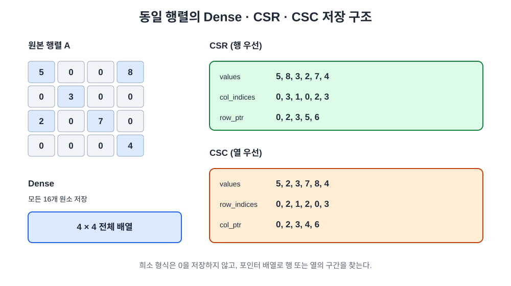

## 2. 구현 구조와 개별 파일 설명

### 2.1 전체 설계

프로젝트는 자료구조 구현, 데이터 생성, 벤치마크, 실행 진입점, 테스트, 결과 후처리를 분리하였다. 이 구조를 통해 알고리즘 구현을 수정하더라도 실험 실행 및 CSV 후처리 코드를 전부 바꾸지 않도록 하였다.

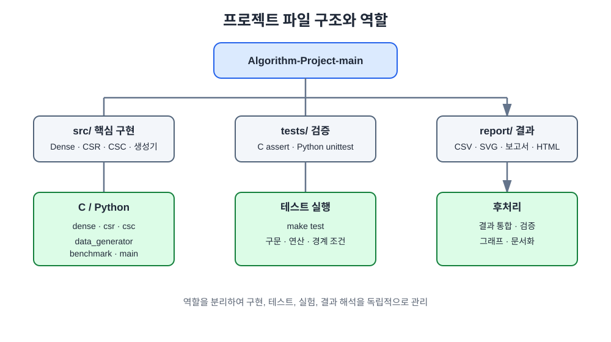

### 2.2 C언어 구현 파일

| 파일 | 역할과 작동 방식 |
|---|---|
| `src/dense.h`, `src/dense.c` | Dense 행렬-벡터 곱셈의 인터페이스와 구현을 담당한다. 바깥 반복문은 행을, 안쪽 반복문은 열을 순회하며 각 행의 내적을 `y[i]`에 누적한다. |
| `src/csr.h`, `src/csr.c` | CSR 구조체와 변환·계산·해제 함수를 제공한다. 먼저 비제로 원소 수를 세고 배열을 할당한 뒤, 행을 순회하며 값과 열 인덱스를 저장한다. `indptr[i]`와 `indptr[i+1]`이 i번째 행의 데이터 구간을 가리킨다. 계산할 때는 이 구간만 순회한다. |
| `src/csc.h`, `src/csc.c` | CSC 구조체와 변환·계산·해제 함수를 제공한다. 열을 먼저 순회하여 각 열의 비제로 값과 행 인덱스를 저장한다. 곱셈에서는 열 번호에 해당하는 `x[j]`를 곱하고, 저장된 행 인덱스의 결과 위치에 누적한다. |
| `src/data_generator.h`, `src/data_generator.c` | 행렬 구조 열거형, 생성 함수, 메모리 해제 함수를 정의한다. 목표 Density에 맞는 NNZ를 계산한 뒤 Random·Banded·Row·Block 구조에 맞는 후보 위치를 만들고, 그중 필요한 수만큼 선택해 1~10의 값을 배치한다. |
| `src/benchmark.h`, `src/benchmark.c` | 실행 시간과 메모리 사용량을 측정한다. 단조 증가 시계인 `CLOCK_MONOTONIC`을 사용하며, 7회 측정값의 중앙값을 반환한다. 행렬 크기에 따라 반복 횟수를 조절해 짧은 연산의 측정 오차를 줄인다. 변환 시간은 변환 후 임시 자료구조를 해제하는 과정을 포함해 측정한다. |
| `src/main.c` | 기본 구조 실험의 실행 진입점이다. 행렬·벡터 생성, Dense 계산, CSR·CSC 변환과 계산, 결과 검증, 벤치마크, CSV 저장 및 동적 메모리 해제를 순서대로 수행한다. |
| `src/main_density.c` | Density 심화 실험의 C 실행 진입점이다. 크기 100·500·1000·2000, Density 1~50%(1% 간격), 네 구조를 반복 실행하고 `c_density_results.csv`를 생성한다. |

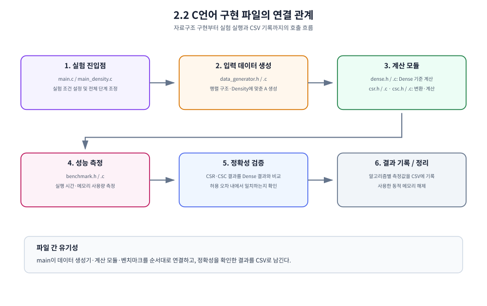

### 2.3 Python 구현 파일

| 파일 | 역할과 작동 방식 |
|---|---|
| `src/dense.py` | 리스트로 표현된 Dense 행렬의 각 행과 벡터의 내적을 계산한다. |
| `src/csr.py` | Dense 행렬을 행 단위로 읽어 `data`, `indices`, `indptr` 리스트를 만든다. `csr_matvec`은 `indptr`로 각 행의 구간을 찾아 비제로 원소만 계산한다. |
| `src/csc.py` | Dense 행렬을 열 단위로 읽어 CSC 배열을 만든다. `csc_matvec`은 열별 구간을 순회하고 해당 행의 결과에 곱을 누적한다. 결과 벡터의 길이를 정확히 유지하기 위해 행 개수 `m`을 인자로 받는다. |
| `src/data_generator.py` | `random.Random(seed)`를 사용해 행렬을 생성한다. `seed=42`를 기본값으로 두어 동일한 Python 조건에서 재현 가능한 입력을 만든다. 목표 NNZ는 C 구현과 같은 반올림 규칙으로 계산한다. |
| `src/benchmark.py` | `time.perf_counter()`로 연산 시간을 측정하고 20회 측정값의 중앙값을 사용한다. `sys.getsizeof()`를 재귀적으로 적용해 리스트와 그 내부 객체의 메모리 크기를 추정한다. |
| `src/main.py` | 기본 구조 실험을 실행한다. 크기 100·500·1000·2000, 대표 Density 1·5·10·30·50%, 네 구조를 조합하여 결과를 CSV에 기록한다. |
| `src/main_density.py` | Density를 1~50%까지 1% 간격으로 바꿔 심화 실험을 수행하고 `python_density_results.csv`를 만든다. 변환 시간은 워밍업 후 20회 반복한 중앙값으로 별도 기록한다. |

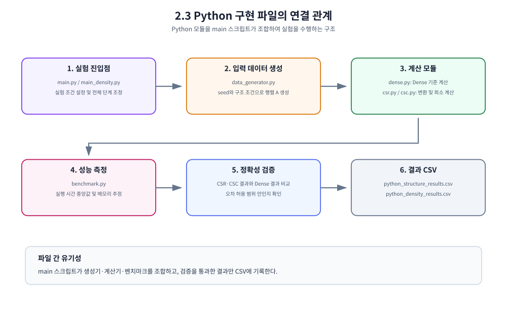

### 2.4 결과 통합·검증·시각화 파일

| 파일 | 역할과 작동 방식 |
|---|---|
| `src/merge_results.py` | C와 Python의 기본 구조 실험 CSV를 읽어 필수 열과 행 개수를 확인한 뒤 `combined_structure_results.csv`로 통합한다. |
| `src/merge_density_results.py` | Density 심화 실험의 C·Python CSV를 통합하여 `combined_density_results.csv`를 생성한다. 입력 언어와 필수 열, 언어별 결과 행 개수를 확인한다. |
| `src/validate_results.py` | Density 통합 결과의 데이터 수, 조건 누락·중복, Density와 NNZ 관계, 알고리즘 간 NNZ 일치, `valid` 값 등을 검사한다. 검증 요약을 텍스트 파일로 저장한다. |
| `src/plot_results.py` | 기본 구조 실험 CSV를 읽어 크기·Density·메모리·언어 비교 그래프를 생성한다. |
| `src/plot_density_results.py` | Density별 실행 시간·메모리·변환 비용 등을 분석하고 그래프 및 `density_crossover_summary.csv`를 생성한다. |
| `tests/test.c` | 직사각형 행렬, 전체가 0인 행렬, 네 가지 데이터 구조의 생성 및 NNZ를 검사한다. 계산 결과는 허용 오차를 두고 비교한다. |
| `tests/test.py` | Python 소스 구문, Dense·CSR·CSC 결과 일치, 영행렬 처리, 생성기 재현성 및 잘못된 입력 처리를 `unittest`로 검사한다. |
| `Makefile` | C 구문 검사와 C·Python 테스트 및 실행을 명령으로 묶는다. `make test`, `make run` 등을 제공한다. |

### 2.5 실험 실행 흐름

먼저 `make test`로 C 소스 구문과 C·Python 핵심 기능을 확인한다. 테스트가 통과하면 실행 프로그램이 행렬과 벡터를 생성하고, Dense 계산을 기준 결과로 삼아 CSR·CSC 계산 결과를 비교한다. 정확성 검증을 통과한 실험은 벤치마크 측정값과 함께 CSV로 저장한다. 이후 통합·검증 스크립트가 결과를 정리하고 그래프 스크립트가 PNG 그래프를 생성하며, 보고서에는 실험 CSV를 바탕으로 별도 제작한 SVG 벡터 그래프도 함께 배치하였다.

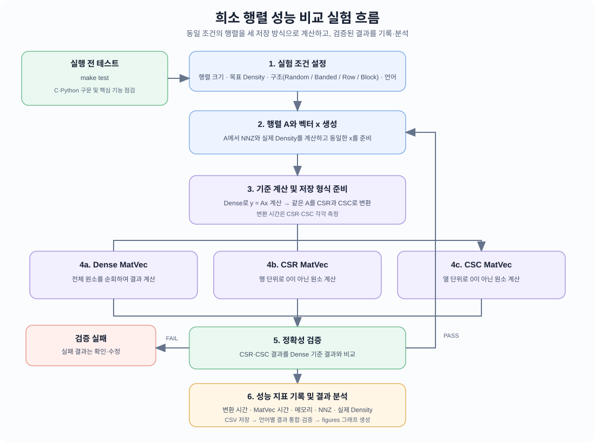

## 3. 코드 작동 원리

### 3.1 Dense 행렬-벡터 곱셈

Dense 구현은 가장 직관적인 기준 구현이다. 먼저 결과 벡터의 각 행 위치를 0으로 초기화한다. 이후 해당 행의 모든 열을 순회하며 `A[i][j]`와 `x[j]`의 곱을 결과에 누적한다. 따라서 0인 원소도 배열에 저장되어 있고 반복문에서 확인된다. 행렬 크기가 m×n이면 모든 원소를 순회하므로 시간 복잡도는 \(O(mn)\)이다.

### 3.2 CSR 변환과 계산

CSR 변환은 두 단계로 진행된다. 첫 번째 단계에서 전체 행렬을 확인해 0이 아닌 원소의 개수인 NNZ를 센다. 이 값을 이용해 `data`와 `indices`의 공간을 할당하고, 행 개수보다 하나 긴 `indptr`를 만든다. 두 번째 단계에서는 각 행을 왼쪽에서 오른쪽으로 순회하면서 0이 아닌 값은 `data`에, 열 번호는 `indices`에 기록한다. 각 행을 시작하기 전에 현재 저장 위치를 `indptr`에 기록하고 마지막에는 전체 NNZ를 마지막 포인터에 저장한다.

곱셈 단계에서는 i번째 행에 해당하는 `indptr[i]`부터 `indptr[i+1]` 직전까지 순회한다. 저장된 열 인덱스를 이용해 벡터의 해당 위치를 찾고 값과 곱해 `y[i]`에 누적한다. 행렬에 0이 아닌 원소가 NNZ개라면 계산은 주로 NNZ에 비례하며, 포인터 배열을 포함한 저장 공간은 \(O(NNZ+m)\)이다.

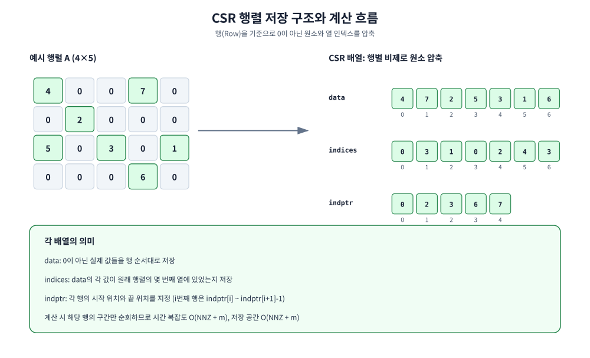

### 3.3 CSC 변환과 계산

CSC는 CSR의 행과 열을 바꾼 방식이다. 변환 시 열을 먼저 순회하며 0이 아닌 값을 `data`에, 해당 값이 위치한 행을 `indices`에 저장한다. `indptr[j]`와 `indptr[j+1]`은 j번째 열의 저장 구간을 나타낸다.

곱셈을 시작할 때 결과 벡터 전체를 0으로 초기화한다. 이후 각 열 j의 비제로 원소를 순회하면서 `data[k] * x[j]`를 해당 행 `indices[k]`에 누적한다. CSC에서는 0이 아닌 원소가 없는 행이 `indices`에 전혀 나타나지 않을 수 있으므로, 전체 행 개수를 인덱스 배열만으로 추론하지 않고 `rows`를 별도로 전달한다. 저장 공간은 \(O(NNZ+n)\)이다.

### 3.4 저장 방식별 행렬-벡터 곱셈 시간 복잡도 비교

세 가지 저장 방식은 행렬-벡터 곱셈을 수행하는 과정에서 서로 다른 시간 복잡도를 가진다.

| 저장 방식 | 시간 복잡도 | 계산 과정 |
|---|---|---|
| Dense | \(O(mn)\) | 전체 행렬 원소를 순회하며 곱셈 수행 |
| CSR | \(O(m+NNZ)\) | 결과 벡터 초기화 후 비제로 원소만 순회 |
| CSC | \(O(m+NNZ)\) | 결과 벡터 초기화 후 비제로 원소만 순회하며 결과에 누적 |

Dense는 행렬의 모든 원소를 확인해야 하므로 행렬 크기가 \(m\times n\)일 때 \(O(mn)\)의 시간이 필요하다. 반면 CSR과 CSC는 결과 벡터를 먼저 0으로 초기화하는 과정에서 \(O(m)\)의 시간이 소요되고, 이후 0이 아닌 원소만 순회하므로 \(O(NNZ)\)의 시간이 추가된다. 따라서 전체 시간 복잡도는 \(O(m+NNZ)\)로 표현할 수 있다.

이를 통해 행렬의 크기가 같더라도 비제로 원소의 개수가 적은 희소 행렬에서는 CSR과 CSC가 Dense보다 적은 연산으로 행렬-벡터 곱셈을 수행할 수 있음을 알 수 있다. 다만 실제 실행 시간은 저장 방식뿐 아니라 자료구조 접근 방식과 구현 언어에도 영향을 받는다.

### 3.5 데이터 생성 방식과 Density

Density(0이 아닌 원소 밀도)는 전체 행렬 원소 중 0이 아닌 원소가 차지하는 비율을 의미한다. Density가 낮을수록 0인 원소가 많아지므로 일반적으로 희소 행렬 저장 방식이 유리해질 가능성이 높다.

$$
\text{Density} = \frac{NNZ}{m \times n} 
$$

여기서 (NNZ)는 0이 아닌 원소의 개수이며, (m)과 (n)은 각각 행과 열의 개수이다. 계산 결과는 0~1 사이의 비율로 나타나며, 백분율로 표현할 때는 100을 곱한다.

$$
\text{Density} = \frac{NNZ}{m \times n} \times 100
$$

데이터 생성기는 목표 Density로부터 NNZ를 반올림하여 계산한 뒤, 해당 개수만큼 비제로 위치를 선정하며, 0이 아닌 값은 1~10 범위에서 생성하도록 설계하였다.

행렬을 생성할 때는 네 가지 분포 구조를 사용하였다.

- **Random:** 전체 행렬 위치를 후보로 하여 0이 아닌 원소의 위치를 선택
- **Banded:** 주대각선 주변의 제한된 폭 안에서 후보 위치를 선택
- **Row:** 위쪽의 일부 행에 원소가 집중되도록 후보 위치를 구성
- **Block:** 행렬의 일부 영역에 원소가 모이도록 후보 위치를 구성

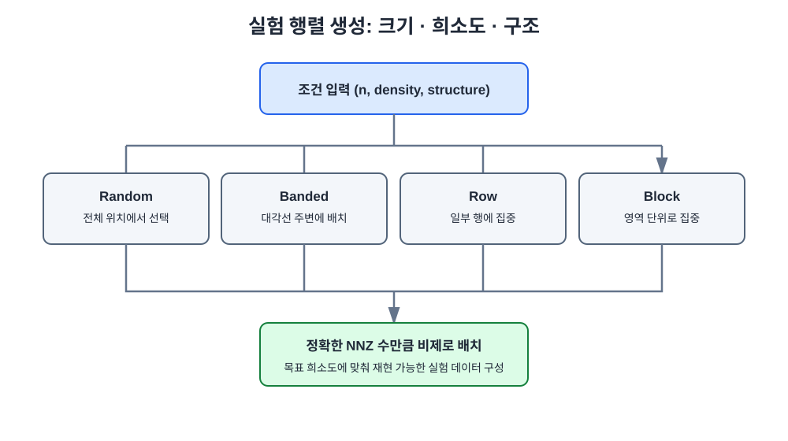

Python 생성기는 `random.Random(42)`로 시드를 고정하고, C 생성기는 실행 진입점에서 `srand(42)`를 사용한다. 다만 C와 Python의 난수 생성 알고리즘은 서로 다르므로, 시드 숫자가 같다고 해서 두 언어에서 0이 아닌 원소의 위치와 값이 동일해진다고 볼 수 없기 때문에, 실제 검증 파일에도 이 차이를 추가 확인 사항으로 기록하였다.

### 3.6 측정 기준

| 항목 | 의미 | 해석 시 유의점 |
|---|---|---|
| `conversion_ms` | Dense에서 CSR 또는 CSC로 변환하는 데 걸린 시간 | Dense는 원래 표현이므로 0으로 기록한다. |
| `matvec_ms` | 해당 표현으로 행렬-벡터 곱셈을 수행한 시간 | 변환 비용을 포함하지 않은 계산 시간이다. |
| `memory_bytes` | 해당 표현을 저장하는 데 필요한 메모리 추정치 | C와 Python의 계산 범위가 달라 언어 간 절대값 비교에 주의한다. |
| `nnz` | 0이 아닌 원소 개수 | 같은 실험 조건의 세 알고리즘에서 동일해야 한다. |
| `actual_density` | 실제 NNZ를 이용해 계산한 Density(비제로 원소 밀도) | 0~1 사이의 비율로 저장하며, 목표 Density와 일치하는지 검증한다. |
| `valid` | CSR·CSC 결과가 Dense 기준 결과와 일치하는지 여부 | 1은 검증 통과를 의미한다. |

C 벤치마크는 `CLOCK_MONOTONIC`을 사용해 7회 측정한 중앙값을 기록하고, 행렬 크기에 따라 반복 횟수를 조정하며 Python 벤치마크는 `time.perf_counter()`를 사용해 20회 측정한 중앙값을 기록한다. 따라서 C와 Python의 절대 실행 시간은 각 언어의 구현 및 측정 방식 차이를 고려하여 해석하였다.

## 4. 실험 설계와 진행 과정

### 4.1 기본 구조 실험

기본 실험에서는 행렬 크기 100, 500, 1000, 2000과 대표 Density 1%, 5%, 10%, 30%, 50%를 사용하였다. Random, Banded, Row, Block 네 가지 구조를 조합하고 Dense, CSR, CSC의 결과를 측정하였다. 기본 통합 CSV에는 C 240행, Python 240행으로 총 480행이 기록되어 있다.

### 4.2 Density 심화 실험

기본 실험 이후 Density 변화에 따른 성능의 변화를 더 세밀하게 관찰하기 위해 1%부터 50%까지 1% 간격으로 실험 범위를 확장하였다. 크기 네 종류, 구조 네 종류, Density 50개, 알고리즘 세 종류를 언어별로 실행하여 언어당 2,400행, 총 4,800행을 생성하였다.

기본 실험과 심화 실험의 실행 파일 및 결과 파일을 구분하여 기존 결과가 덮어써지지 않도록 관리하였다. 기본 실험은 `main.c`, `main.py`를 사용하고, Density 실험은 `main_density.c`, `main_density.py`를 사용한다. 결과도 `*_structure_results.csv`와 `*_density_results.csv`로 나누어 저장한다.

### 4.3 검증 과정

C와 Python의 개별 결과를 통합한 뒤 `validate_results.py`로 다음 항목을 검사하였다.

1. 전체 데이터가 4,800행이며 C와 Python이 각각 2,400행인지 확인한다.
2. 네 가지 구조별 데이터 개수가 언어마다 600행인지 확인한다.
3. 크기·Density·구조별 조건이 누락되지 않았는지 확인한다.
4. 모든 실험에서 `valid=1`인지 확인한다.
5. `actual_density = nnz / (rows × cols)` 관계와 목표 Density에 따른 NNZ 반올림 값이 일치하는지 확인한다.
6. 같은 실험 조건에서 Dense·CSR·CSC의 NNZ와 실제 Density가 일치하는지 확인한다.
7. 중복 실험 데이터가 없는지 확인한다.

검증 결과는 `report/density_validation_summary.txt`에 저장되어 있으며, 기록된 오류 항목은 없다. 단, C와 Python의 난수 생성 방식 차이, CSV에 행렬 원본이 저장되지 않은 점, 메모리 측정 기준 차이는 경고 항목으로 남아 있다.

### 4.4 프로젝트 진행 과정

프로젝트는 MATLAB 사용 경험에서 출발한 질문을 구체적인 비교 문제로 바꾸는 것부터 시작하였다. 먼저 Dense 방식으로 기준 계산을 만들고, CSR과 CSC의 자료구조를 직접 구성하여 같은 행렬-벡터 곱셈을 구현하였다. 초기에는 작은 직사각형 행렬과 전체가 0인 행렬을 이용해 결과가 일치하는지 확인하였다.

이후 C와 Python으로 데이터 생성기와 벤치마크를 확장하였다. 실험 조건이 늘어나면서 행렬 크기, Density, 구조를 일정한 목록으로 관리하고, 실행 파일과 CSV 결과를 기본 실험 및 심화 실험으로 분리하였다. C와 Python 결과를 합치는 스크립트, 통합 데이터 검증 스크립트, 그래프 생성 스크립트를 추가하여 실험 결과를 반복해서 확인할 수 있는 흐름을 만들었다.

마지막으로 Density를 1% 간격으로 확장해 4,800행의 데이터를 생성하고, 검증 요약과 교차점 분석 CSV를 통해 저장 공간 및 변환 비용을 포함한 결과를 확인하였다.

## 5. 실험 결과

### 5.1 결과 데이터 개요

| 실험 | 행렬 크기 | Density | 구조 | 언어 | 결과 행 수 |
|---|---|---|---|---|---:|
| 기본 구조 실험 | 100, 500, 1000, 2000 | 1, 5, 10, 30, 50% | 4종 | C, Python | 480 |
| Density 심화 실험 | 100, 500, 1000, 2000 | 1~50%, 1% 간격 | 4종 | C, Python | 4,800 |

### 5.2 C 구현에서 Density에 따른 계산 시간

아래 그래프는 C 구현의 Random 구조, 1000×1000 행렬에서 Density를 1~50%로 변화시킨 결과이다.

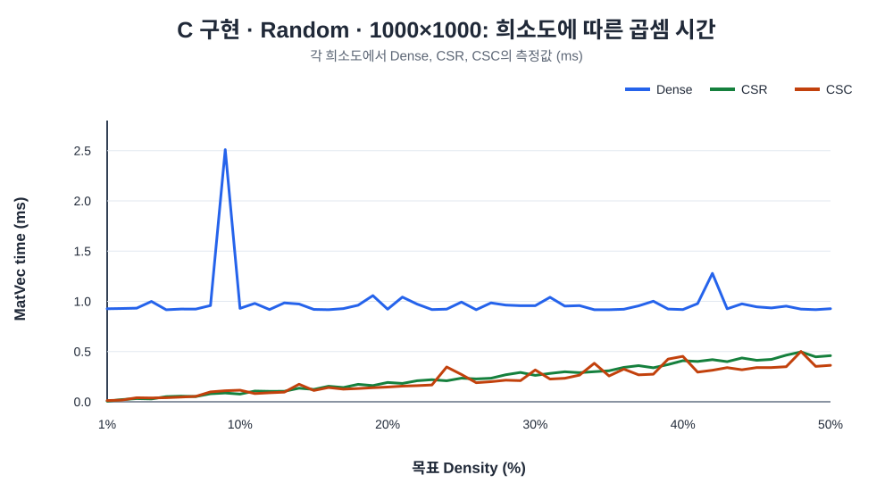

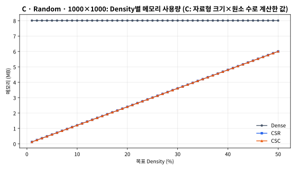

Density 10% 조건의 측정값을 예로 들면 Dense의 행렬-벡터 곱셈 시간은 약 0.930 ms, CSR은 약 0.077 ms, CSC는 약 0.115 ms였다. 이 조건에서는 희소 형식이 0인 원소를 건너뛰기 때문에 곱셈만 놓고 보면 CSR과 CSC가 더 짧은 시간이 걸렸다. Density가 50%가 되면 CSR 약 0.459 ms, CSC 약 0.363 ms로 증가하여, 비제로 원소가 많아질수록 희소 형식의 계산량도 증가하는 경향을 보였다.

### 5.3 행렬 크기에 따른 계산 및 메모리 변화

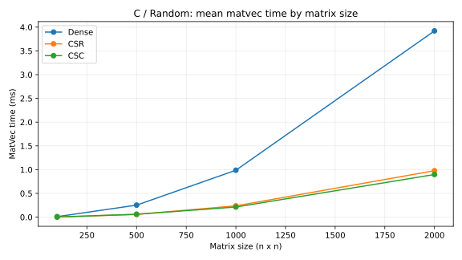

C 구현의 Random 구조에서 Density별 평균을 살펴보면 행렬 크기가 커질수록 세 방식의 계산 시간은 모두 증가하였다. 다만 Dense는 모든 원소를 순회하는 반면 CSR·CSC는 비제로 원소를 순회하므로, 낮은 Density에서는 희소 형식의 계산 시간이 훨씬 작았다.

C의 1000×1000 행렬에서 Density 10%일 때 메모리 사용량은 Dense 8,008,000 bytes, CSR 1,204,004 bytes, CSC 1,204,004 bytes로 기록되었다. 이 조건에서 CSR과 CSC는 Dense보다 훨씬 적은 저장 공간을 사용했다. CSR과 CSC의 메모리 공식은 각각 값·인덱스 배열과 포인터 배열을 합산한 것이며, Dense는 전체 double 원소와 행 포인터 배열을 포함한다.

### 5.4 변환 비용을 포함한 해석

희소 형식은 계산 시간이 짧더라도 Dense 행렬을 CSR 또는 CSC로 변환하는 비용이 추가된다. 따라서 `matvec_ms`만으로 최종 선택을 결정하면 안 된다. Density 교차점 분석 파일에서는 C 구현의 모든 구조·크기 조건에서 `total_ms` 기준으로 “처음부터 Dense가 유리”로 분류되었다. 이는 현재 벤치마크의 단일 변환 및 계산 비용 기준에서 변환 비용이 크게 작용한 결과다.

반면 Python 결과에서는 모든 구조·크기 조건에서 `total_ms` 역전이 발생한 것으로 요약되었다. Python은 Dense의 리스트 순회 비용이 큰 반면, 희소 형식은 0이 아닌 원소만 처리하므로 변환 비용을 포함해도 유리해지는 Density 구간이 나타났다. 예를 들어 Python Random 1000×1000, Density 10% 조건에서 Dense 계산 시간은 약 68.93 ms, CSR 변환 시간은 약 38.87 ms, CSR 계산 시간은 약 9.03 ms였다. 단순 합산하면 CSR의 변환+계산은 약 47.90 ms로 Dense 계산보다 작다.

다만 `total_ms`는 Dense에서 CSR 또는 CSC로 변환하는 데 걸리는 `conversion_ms`와 변환된 자료구조로 한 번의 행렬-벡터 곱셈을 수행하는 `matvec_ms`를 합산한 분석 지표이다. 동일한 행렬을 여러 번 재사용한다면 최초 변환 비용은 한 번만 발생하고, 이후에는 변환된 자료구조를 이용해 행렬-벡터 곱셈을 반복할 수 있다.

반복 연산 횟수를 \(k\)라고 하면, CSR의 전체 계산 시간은 다음과 같이 나타낼 수 있다.

$$
T_{\text{CSR}}(k) = T_{\text{CSR conversion}} + k \times T_{\text{CSR matvec}}
$$

CSC도 같은 방식으로 표현할 수 있다.

$$
T_{\text{CSC}}(k) = T_{\text{CSC conversion}} + k \times T_{\text{CSC matvec}}
$$

반면 Dense는 별도의 변환 과정이 없으므로 다음과 같다.

$$
T_{\text{Dense}}(k) = k \times T_{\text{Dense matvec}}
$$

따라서 반복 횟수가 증가할수록 희소 형식에서 최초 변환 비용이 전체 계산 시간에서 차지하는 비중은 감소한다. 한 번의 행렬-벡터 곱셈에서는 Dense가 유리하더라도 동일한 행렬을 여러 번 재사용하는 환경에서는 CSR이나 CSC가 더 효율적일 가능성이 있다. 실제로 어느 시점부터 희소 형식이 유리해지는지는 변환 시간과 각 저장 방식의 행렬-벡터 곱셈 시간에 따라 달라진다.

*여기서 (k)는 동일한 행렬을 이용하여 행렬-벡터 곱셈을 수행하는 반복 횟수를 의미한다. 이때 CSR 또는 CSC로의 변환은 최초 한 번만 수행하며, 이후 반복 연산에서는 이미 변환된 자료구조를 재사용한다고 가정한다. 따라서 매 반복마다 Dense 행렬을 희소 형식으로 다시 변환하는 비용은 포함하지 않는다.

### 5.5 원소 분포 구조에 따른 차이

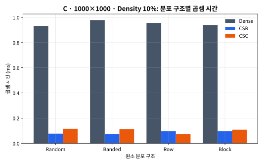

Random, Banded, Row, Block 구조는 같은 Density라도 0이 아닌 원소가 위치하는 패턴이 다르다. 예를 들어 Python의 1000×1000, Density 10% 실험에서 Row 구조의 CSR 메모리 측정값은 약 3,726,500 bytes였고, Block 구조는 약 2,168,888 bytes로 기록되었다. 이는 Python 리스트와 내부 객체의 메모리 크기를 포함하는 현재 측정 방식에서 원소가 분포하는 모양과 실제 생성된 자료구조의 크기가 영향을 줄 수 있음을 보여준다.

이러한 차이를 이해하기 위해서는 Python의 메모리 측정 방식도 고려해야 한다. 본 프로젝트에서는 `sys.getsizeof()`를 재귀적으로 적용하여 리스트 자체뿐 아니라 리스트 내부에 저장된 객체의 크기도 합산하였다. Python 리스트는 실제 데이터 외에도 각 원소에 대한 객체 참조를 관리하기 위한 추가 공간을 사용하며, 내부에 저장되는 객체의 메모리도 측정값에 반영된다.

따라서 Python에서는 비제로 원소의 개수가 같더라도 실제 리스트와 내부 객체의 구성에 따라 측정되는 메모리 사용량이 달라질 수 있다. 다만 이번 결과만으로 Row와 Block의 공간적 분포 자체가 메모리 차이를 발생시킨 직접적인 원인이라고 단정하기는 어렵다. Python의 자료구조 구성과 메모리 측정 방식이 함께 영향을 미쳤을 가능성을 고려해야 한다.

반면 C 구현에서는 CSR·CSC의 메모리 계산식이 NNZ와 행 또는 열 포인터 길이를 기준으로 하므로 같은 크기와 NNZ 조건에서 메모리 수치가 구조별로 동일하게 나타난다. 즉, 메모리 수치가 구조를 반영하는 정도도 언어별 측정 방법에 따라 다르다.

### 5.6 C와 Python 비교의 주의점

C는 자료형 크기를 바탕으로 배열 메모리를 계산하고, Python은 `sys.getsizeof()`로 리스트와 그 내부 객체의 크기를 재귀적으로 합산한다. 두 측정값은 포함하는 오버헤드가 다르므로 절대적인 bytes를 직접 비교하기 어렵다. 또한 두 언어의 난수 생성 방식이 달라 같은 Seed를 사용해도 행렬 원소의 위치와 값은 동일하지 않다. Density 실험의 C 실행부는 입력 벡터도 `rand()`로 생성하는 반면 Python은 열 인덱스에 기반한 고정 벡터를 사용하므로, 두 언어 간 입력 벡터 조건도 완전히 일치하지 않는다. 따라서 언어 간 결과는 완전히 동일한 입력의 통제 실험이라기보다, 동일한 크기·목표 Density·구조 조건에서 구현 방식별 경향을 살펴보는 비교로 해석하는 것이 타당하다.

## 6. 결과 해석과 장단점

### 6.1 방식별 장단점

| 방식 | 장점 | 단점 | 적합한 상황 |
|---|---|---|---|
| Dense | 구현과 인덱싱이 단순하고 변환 과정이 필요 없다. | 0도 저장하고 순회하므로 희소 행렬에서 낭비가 발생한다. | 밀도가 높거나 변환 비용을 피해야 하는 경우 |
| CSR | 행별 0이 아닌 원소만 순회하여 행 단위 계산에 적합하다. | 행렬 변환이 필요하고 행 단위 구조에 맞춘 접근이다. | 희소 행렬의 행별 연산 및 반복 계산 |
| CSC | 열별 0이 아닌 원소만 순회하고 열 단위 연산에 적합하다. | 변환 비용이 발생하고 결과 벡터에 누적하는 형태다. | 열 기준 접근이나 열 단위 연산이 중요한 경우 |

### 6.2 핵심 해석

이번 실험에서 확인할 수 있었던 중요한 점은 희소 행렬 형식이 항상 모든 상황에서 빠르지는 않다는 것이다. CSR과 CSC는 0이 아닌 원소가 적을수록 계산량과 저장 공간을 줄일 수 있지만, Dense에서 희소 형식으로 바꾸는 변환 시간이 추가된다. 한 번만 곱셈을 수행하는지, 같은 행렬을 여러 번 재사용하는지에 따라 유리한 방식이 달라질 수 있다.

또한 CSR과 CSC는 모두 0이 아닌 원소만 저장하지만 데이터 순회 방향이 다르다. CSR은 행을 기준으로 결과의 각 원소를 계산하고, CSC는 열을 기준으로 결과 벡터 여러 위치에 누적한다. 따라서 어떤 저장 방식이 더 적합한지는 희소도뿐 아니라 이후 수행할 연산의 접근 방향과 데이터 재사용 조건도 함께 고려해야 한다.

## 7. 작동 과정 시각화

`matvec-visualizer.html`은 별도 라이브러리 설치 없이 브라우저에서 열 수 있는 인터랙티브 시각화 파일이다. Dense·CSR·CSC를 선택하고 이전 단계·다음 단계 버튼을 누르면 동일한 예제 행렬에서 각 방식이 어떤 원소를 확인하고 결과 벡터에 누적하는지 단계별로 확인할 수 있다.

파일 위치: [`report/matvec-visualizer.html`](./matvec-visualizer.html)

## 8. 결론

이번 프로젝트를 진행하면서 희소도(Density)라는 개념을 새롭게 배울 수 있었다. 희소도 개념에 대한 이해를 바탕으로, 직접 작성한 데이터 생성기로 여러 희소도의 행렬들을 만들면서 전체 원소 중 0이 아닌 원소가 차지하는 비율을 수치로 나타낼 수 있다는 것을 이해할 수 있었다. 이를 바탕으로 실험을 진행하며 희소도에 따라 저장 방식의 메모리 사용량과 계산 성능이 달라질 수 있다는 것을 알게 되었다. 최대한 동일한 조건에서의 실험을 위한 데이터 생성기를 제작하며, 난수 생성과 Seed의 역할을 더욱 깊게 이해할 수 있었다. Seed를 고정하면 동일한 생성기와 조건 안에서 반복 가능한 결과를 만들 수 있어 실험 재현성에 도움이 된다는 것을 활용하여 데이터 생성기를 만들었지만, 이번 프로젝트에서 C와 Python은 서로 다른 난수 생성기를 사용하기 때문에 Seed 값만 같다고 해서 실제 행렬이 완전히 동일해지는 것은 아니며, 이를 보완하기 위해서는 난수 생성기의 생성 과정도 고려해야 한다는 점을 배웠다. CSC 자료구조를 구현하면서 행렬의 행 개수를 별도로 전달해야 하는 이유를 이해할 수 있었다. CSC의 행 인덱스 배열에는 실제 비제로 원소가 존재하는 행만 기록되기 때문에, 특정 행이 모두 0이면 그 행 번호가 나타나지 않는다. 따라서 저장된 인덱스만으로는 원래 행렬의 전체 행 수를 알 수 없으며, 행의 개수 `m`을 별도로 전달해야 한다. C언어에서는 `malloc()`과 `free()`를 이용해 행렬 및 압축 배열의 메모리를 직접 관리하였는데, 수업에서 배운 동적 메모리 할당을 실제 자료구조 구현에 적용하면서 메모리 할당뿐 아니라 실패했을 때의 정리와 사용이 끝난 뒤 해제하는 과정도 중요하다는 내용을 직접 수행할 수 있어 흥미롭게 실험을 진행할 수 있었다. 또한 테스트 케이스 구성, 실행 시간 측정, 결과 검증, CSV 통합, 그래프 생성까지 실험 전체의 흐름을 자연스럽게 이어지도록 코드 및 파일들을 관리하는 능력을 키울 수 있었다. 특히 Density 심화 실험을 추가하면서 기존 실험과 새 실험의 실행 파일 및 결과 파일을 분리해 관리하는 것이 중요하다는 점을 배웠고, 이를 실천하였다.

결국 행렬 저장 방식은 단순히 데이터를 메모리에 보관하는 방법의 차이가 아니라 실제 계산량과 메모리 사용량, 변환 비용에 영향을 주는 중요한 요소라는 것을 알게 되었다. 또한 알고리즘의 성능을 평가할 때는 하나의 실행 시간만 비교하기보다 행렬 크기, 희소도, 원소 분포, 변환 비용, 반복 사용 여부와 측정 기준을 함께 고려해야 한다는 점을 이해하였다.

## 9. 참고 자료 및 AI 사용 내역

### 참고 자료

-사용한 AI : Copilot, Chat GPT

1. [고급알고리즘 개인프로젝트 지침](https://lec-algorithm.github.io/lecture/article/project-2026/)
2. [SciPy Tutorial — Sparse matrices](https://docs.scipy.org/doc/scipy/tutorial/sparse.html)
3. [Netlib — Templates for the Solution of Linear Systems](https://netlib.sandia.gov/templates/templates.pdf)
4. [Intel oneMKL — Sparse Storage Formats](https://www.intel.com/content/www/us/en/docs/onemkl/developer-reference-dpcpp/2026-2/sparse-storage-formats.html)
